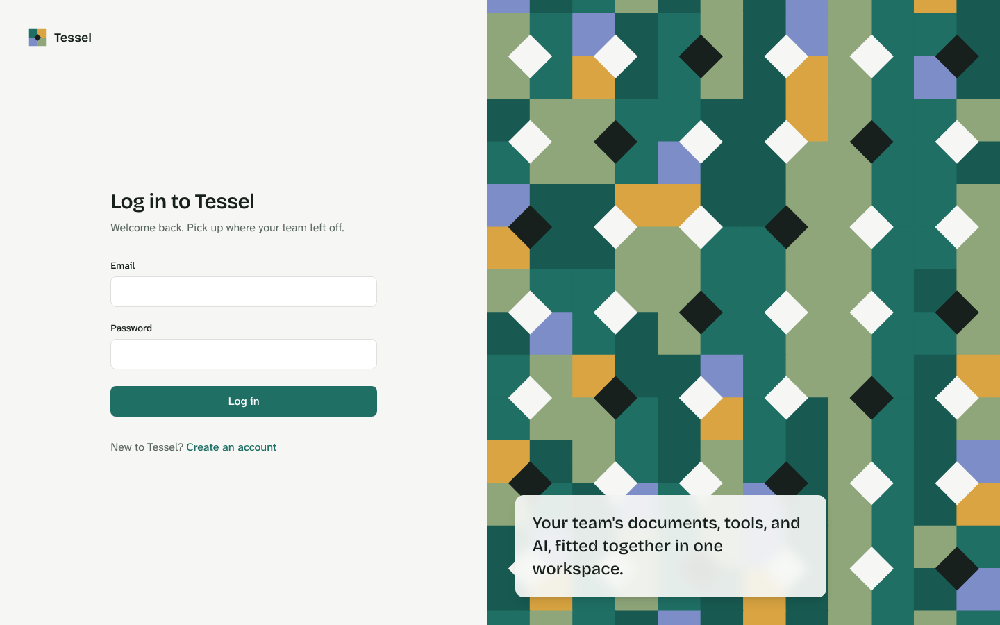
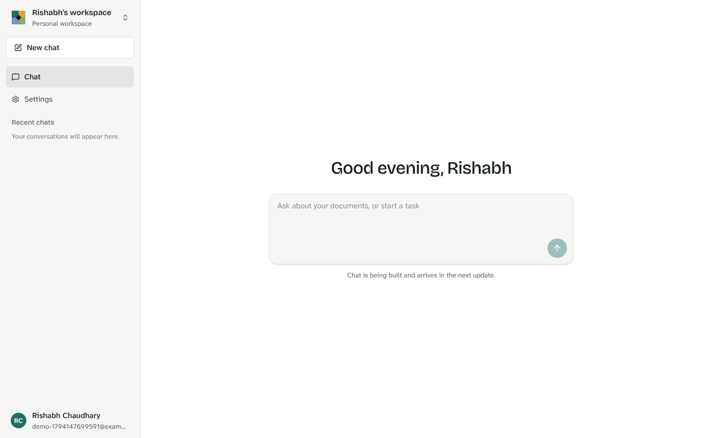
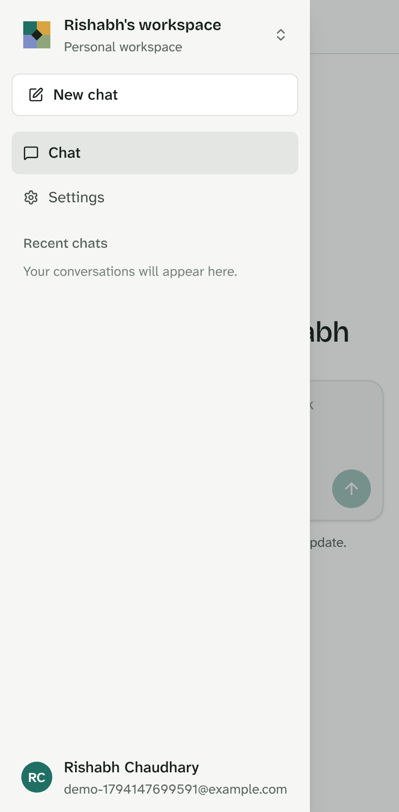
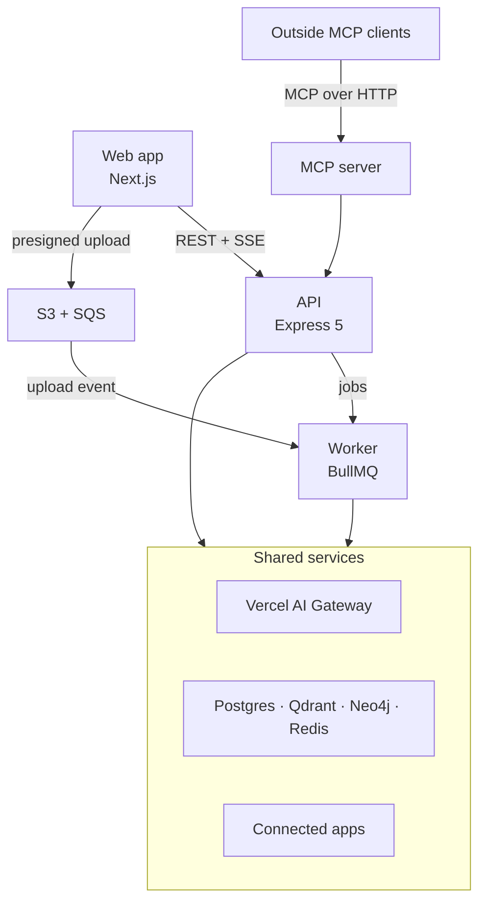

# Tessel

[](https://github.com/chaudhary-rishabh/tessel/actions/workflows/ci.yml)

An AI workspace for teams. Tessel lets a team chat with AI over its own documents, run agents that use tools and ask before risky actions, and connect outside apps through MCP, all in one place.

> **Status:** In active development. Phase 1 is being built in 20 steps; see the [roadmap](docs/ROADMAP.md).

## Screenshots

| Log in                                                            | Workspace (desktop)                                                             | Navigation (phone)                                                 |
| ----------------------------------------------------------------- | ------------------------------------------------------------------------------- | ------------------------------------------------------------------ |
|  |  |  |

## What it will do

- **Chat** with streaming answers and a model picker across providers, with every model call capped, moderated, and recorded in a usage ledger.
- **Answer from your documents**: uploads go straight to S3, a worker indexes them, a router decides when a question needs them, and hybrid search plus reranking finds the passages. Answers cite them inline, and each citation opens the passage and its document.
- **Use tools and ask first**: the assistant searches documents, calculates, and creates or deletes documents through a ReAct loop. Anything that changes the workspace waits for Allow or Decline, and a pending question survives reloads and restarts.
- **Pick how it works**: answer straight away, plan and work through steps, draft and review, or hand parts of the task to a team of specialists. Every stage shows live, and approvals work in every mode.
- **Use skills**: built-in and user-created instructions the agent loads when needed.
- **Connect tools through MCP**, both as a client (GitHub, Notion, Slack) and as a server for outside MCP clients.
- **Remember context** across conversations with short-term, summary, long-term, and episodic memory.

## Architecture



Details: [docs/ARCHITECTURE.md](docs/ARCHITECTURE.md) · Key choices and why: [docs/DECISIONS.md](docs/DECISIONS.md)

## Tech stack

| Area           | Choice                                                          |
| -------------- | --------------------------------------------------------------- |
| Monorepo       | Turborepo, pnpm workspaces, TypeScript (strict, ESM)            |
| Frontend       | Next.js, React, Tailwind CSS, TanStack Query, Zustand           |
| Backend        | Express 5, Zod, Drizzle ORM                                     |
| AI             | LangChain, LangGraph, Vercel AI Gateway, AI SDK                 |
| Data           | PostgreSQL, Qdrant, Neo4j, Redis (cache and queue), S3          |
| Jobs           | BullMQ, SQS                                                     |
| Quality        | Vitest, Supertest, Playwright, ESLint, Prettier, GitHub Actions |
| Infrastructure | Docker, Amazon ECR, EC2                                         |

## Repository layout

```text
apps/
  web/          Next.js user app
  api/          Express 5 API
  worker/       Background jobs and upload events
  mcp-server/   MCP server for outside clients
packages/
  config/       tsconfig presets, env loading and validation
  logger/       Structured logging with secret redaction
  contracts/    Zod schemas shared by frontend and backend
  db/           Drizzle schema, migrations, database client
  queue/        Queue names, job schemas, Redis connection
  ai/           Model gateway, registry, spend caps, moderation, ledger, chunking, hybrid search
  storage/      S3 files, SQS upload events, object key layout
  api-client/   axios client with token refresh, typed endpoints, query hooks
  ui/           Shared React components and the Tessel mark
infra/docker/   Dockerfiles and local data services
infra/deploy/   Production Compose stack, Caddy, deploy script
infra/aws/      AWS setup guide, IAM policies, EC2 bootstrap
docs/           Architecture, decisions, roadmap, backlog
```

## Getting started

**Requirements:** Node.js 22.12 or later (24 recommended), pnpm 10, Docker.

```bash
pnpm install
cp .env.example .env
pnpm infra:up        # Postgres, Redis x2, Qdrant, Neo4j, S3 and SQS emulators
pnpm db:migrate      # apply migrations and set up the app database role
pnpm dev             # web :3000, api :4000, mcp-server :4100, worker
```

AI features need an [AI Gateway](https://vercel.com/ai-gateway) key in `AI_GATEWAY_API_KEY`. To work offline, run the mock gateway and point the API at it:

```bash
pnpm --filter @tessel/ai mock-gateway   # then set AI_GATEWAY_API_KEY=mock and AI_GATEWAY_URL=http://127.0.0.1:4300/v1
```

Check that everything is connected:

```bash
curl localhost:4000/health/ready
```

## Scripts

| Command                                | What it does                                     |
| -------------------------------------- | ------------------------------------------------ |
| `pnpm dev`                             | Run every app in watch mode                      |
| `pnpm build`                           | Build every app                                  |
| `pnpm check`                           | Lint, format check, typecheck, and tests         |
| `pnpm test`                            | Run all tests                                    |
| `pnpm test:e2e`                        | Run browser tests on desktop and phone viewports |
| `pnpm infra:up`                        | Start local data services and wait until healthy |
| `pnpm infra:down`                      | Stop local data services                         |
| `pnpm db:generate` / `pnpm db:migrate` | Create and apply database migrations             |

## Deployment

Pushes to `main` that pass CI deploy automatically to AWS: images go to ECR and run on EC2 with Docker Compose, behind Caddy with automatic HTTPS. Every pull request also builds the production images and boots the full stack in CI. One-time setup: [infra/aws/README.md](infra/aws/README.md).

## Contributing

See [CONTRIBUTING.md](CONTRIBUTING.md).
