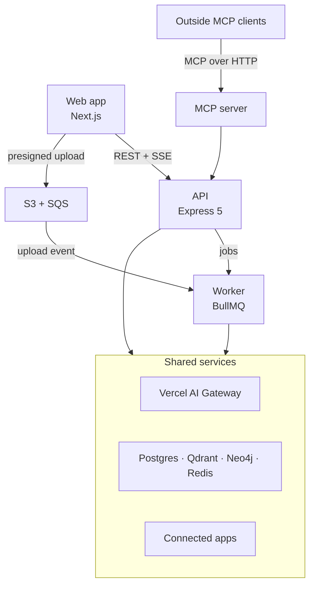

# Tessel

[](https://github.com/chaudhary-rishabh/tessel/actions/workflows/ci.yml)

An AI workspace for teams. Tessel lets a team chat with AI over its own documents, run agents that use tools and ask before risky actions, and connect outside apps through MCP, all in one place.

> **Status:** In active development. Phase 1 is being built in 20 steps; see the [roadmap](docs/ROADMAP.md).

## What it will do

- **Chat** with streaming answers and a model picker across providers.
- **Answer from your documents** with hybrid search, reranking, and citations.
- **Run agents** (ReAct, plan-and-execute, reflection, supervisor) that pause for approval before write actions.
- **Use skills**: built-in and user-created instructions the agent loads when needed.
- **Connect tools through MCP**, both as a client (GitHub, Notion, Slack) and as a server for outside MCP clients.
- **Remember context** across conversations with short-term, summary, long-term, and episodic memory.

## Architecture



Details: [docs/ARCHITECTURE.md](docs/ARCHITECTURE.md) · Key choices and why: [docs/DECISIONS.md](docs/DECISIONS.md)

## Tech stack

| Area           | Choice                                                          |
| -------------- | --------------------------------------------------------------- |
| Monorepo       | Turborepo, pnpm workspaces, TypeScript (strict, ESM)            |
| Frontend       | Next.js, React, Tailwind CSS, TanStack Query, Zustand           |
| Backend        | Express 5, Zod, Drizzle ORM                                     |
| AI             | LangChain, LangGraph, Vercel AI Gateway, AI SDK                 |
| Data           | PostgreSQL, Qdrant, Neo4j, Redis (cache and queue), S3          |
| Jobs           | BullMQ, SQS                                                     |
| Quality        | Vitest, Supertest, Playwright, ESLint, Prettier, GitHub Actions |
| Infrastructure | Docker, Amazon ECR, EC2                                         |

## Repository layout

```text
apps/
  web/          Next.js user app
  api/          Express 5 API
  worker/       Background jobs and upload events
  mcp-server/   MCP server for outside clients
packages/
  config/       tsconfig presets, env loading and validation
  logger/       Structured logging with secret redaction
  contracts/    Zod schemas shared by frontend and backend
  db/           Drizzle schema, migrations, database client
  queue/        Queue names, job schemas, Redis connection
infra/docker/   Local data services (Docker Compose)
docs/           Architecture, decisions, roadmap, backlog
```

## Getting started

**Requirements:** Node.js 22.12 or later (24 recommended), pnpm 10, Docker.

```bash
pnpm install
cp .env.example .env
pnpm infra:up        # Postgres, Redis x2, Qdrant, Neo4j
pnpm dev             # web :3000, api :4000, mcp-server :4100, worker
```

Check that everything is connected:

```bash
curl localhost:4000/health/ready
```

## Scripts

| Command                                | What it does                                     |
| -------------------------------------- | ------------------------------------------------ |
| `pnpm dev`                             | Run every app in watch mode                      |
| `pnpm build`                           | Build every app                                  |
| `pnpm check`                           | Lint, format check, typecheck, and tests         |
| `pnpm test`                            | Run all tests                                    |
| `pnpm infra:up`                        | Start local data services and wait until healthy |
| `pnpm infra:down`                      | Stop local data services                         |
| `pnpm db:generate` / `pnpm db:migrate` | Create and apply database migrations             |

## Contributing

See [CONTRIBUTING.md](CONTRIBUTING.md).
