# Architecture

Tessel is an AI workspace for teams: chat over their own documents, agents that use tools and ask before risky actions, and outside apps connected through MCP. This document describes how the system is put together and the rules every part follows.

## System overview

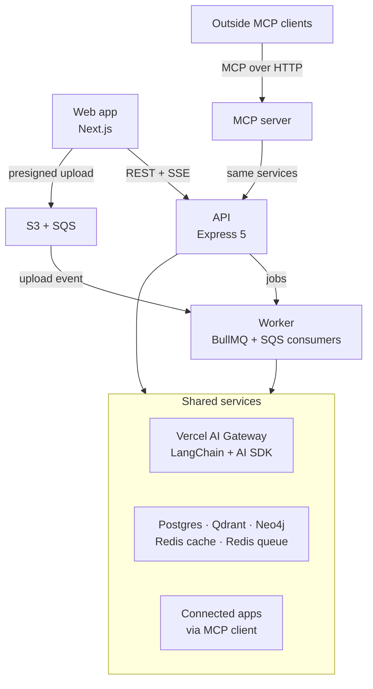

- The web app talks only to the API. Files go straight from the browser to S3.
- Anything slow (ingestion, long agent runs, memory extraction) runs in the worker.
- Every model call goes through `packages/ai` and the Vercel AI Gateway; nothing calls a provider directly.

## Apps

| App               | Purpose                                                     |
| ----------------- | ----------------------------------------------------------- |
| `apps/web`        | Next.js user app: chat, uploads, approvals, settings        |
| `apps/api`        | Express 5 API, split into feature modules                   |
| `apps/worker`     | Background jobs (BullMQ) and S3 upload events (SQS)         |
| `apps/mcp-server` | Exposes workspace search and actions to outside MCP clients |
| `apps/admin`      | Admin app for users, models, usage, and the audit log       |
| `apps/voice`      | Voice agent: listens and talks in LiveKit rooms             |

## Packages

Workspace packages export TypeScript source directly. Apps compile them as part of their own build (Next.js through `transpilePackages`, Node apps through `tsdown`), so there is no separate package build step.

| Package              | Purpose                                              | Added   |
| -------------------- | ---------------------------------------------------- | ------- |
| `@tessel/config`     | Shared tsconfig presets, env loading and validation  | Step 1  |
| `@tessel/logger`     | Structured logging with secret redaction             | Step 1  |
| `@tessel/contracts`  | Zod schemas and types shared by frontend and backend | Step 1  |
| `@tessel/db`         | Drizzle schema, migrations, database client          | Step 1  |
| `@tessel/queue`      | Queue names, job payload schemas, Redis connection   | Step 1  |
| `@tessel/api-client` | axios instance and TanStack Query hooks              | Step 3  |
| `@tessel/ui`         | Shared UI components                                 | Step 3  |
| `@tessel/storage`    | S3 objects, SQS upload events, object key layout     | Step 7  |
| `@tessel/ai`         | Gateway client, model registry, prompts, graphs, RAG | Step 5  |
| `@tessel/tools`      | Built-in tools and the tool registry                 | Step 9  |
| `@tessel/skills`     | Built-in skills                                      | Step 11 |

## Data stores

| Store       | Holds                                                                                                               |
| ----------- | ------------------------------------------------------------------------------------------------------------------- |
| Postgres    | Source of truth: users, workspaces, threads, messages, documents, usage ledger, agent checkpoints, long-term memory |
| Qdrant      | Chunk and memory vectors (dense + sparse), always filtered by workspace                                             |
| Neo4j       | Entities and relationships for graph RAG, always filtered by workspace                                              |
| Redis cache | Caching, rate limits, daily spend counters, live run events. Evicts least-recently-used keys                        |
| Redis queue | BullMQ only. Never evicts, persists to disk                                                                         |
| S3          | Original files, parsed text, artifacts. Keys start with the workspace ID                                            |

The two Redis instances are separate on purpose: a cache must be allowed to evict, and a queue must never lose jobs.

## API module pattern

Each feature in `apps/api/src/modules/<name>/` follows the same layout:

| File              | Job                                                 |
| ----------------- | --------------------------------------------------- |
| `*.routes.ts`     | Routes and the middleware chain                     |
| `*.controller.ts` | Reads the request, sends the response, nothing else |
| `*.service.ts`    | Business logic                                      |
| `*.repository.ts` | Database access                                     |
| `*.schemas.ts`    | Zod schemas, re-exported from `@tessel/contracts`   |
| `*.policy.ts`     | Who can do what                                     |
| `*.test.ts`       | Integration tests                                   |

Every request passes through, in order: request ID (always generated by the API, since it keys usage records; a caller's own ID is only logged), request logging (paths only: query strings and invitation tokens never reach the logs), security headers (helmet), CORS, body parsing (1 MB limit), rate limiting, authentication, Zod validation, permission check, controller, and one shared error handler.

Modules are wired in `apps/api/src/app.ts`: each one exposes factory functions (`createXService`, `createXController`, `createXRouter`), so tests can build the whole app against a test database with cheaper settings.

## Authentication

| Piece           | How it works                                                                                                                                                                                                                                                                                                                                                                                                                          |
| --------------- | ------------------------------------------------------------------------------------------------------------------------------------------------------------------------------------------------------------------------------------------------------------------------------------------------------------------------------------------------------------------------------------------------------------------------------------- |
| Passwords       | Argon2id (19 MiB, 2 iterations). Unknown emails still run a dummy verification so timing doesn't reveal which accounts exist.                                                                                                                                                                                                                                                                                                         |
| Access token    | JWT (HS256), 15 minutes, sent as `Authorization: Bearer`. Carries the user ID and role. Stateless.                                                                                                                                                                                                                                                                                                                                    |
| Refresh token   | 256-bit random value in an httpOnly, `SameSite=Strict`, `Path=/auth` cookie. Stored only as a SHA-256 hash.                                                                                                                                                                                                                                                                                                                           |
| Rotation        | Every refresh retires the presented token and issues a new one in the same family (one family = one login session).                                                                                                                                                                                                                                                                                                                   |
| Reuse detection | Presenting a retired token revokes the whole family. A token rotated less than 10 seconds earlier returns `refresh_token_rotated` instead, because that is almost always two tabs refreshing at once.                                                                                                                                                                                                                                 |
| Password change | Revokes every session for the user and starts a new one.                                                                                                                                                                                                                                                                                                                                                                              |
| Signup          | Email and password create the account and sign in at once (D-100); the name starts from the email and is changed in Settings. A link to confirm the email follows (7 days, newest only, works only while signed in to that account). Until it's confirmed, the account can't accept invitations, and proving the address with Google, GitHub, or a password reset clears every way in set up before (`app.reset_unverified_account`). |
| Password reset  | A one-time link (30 minutes, stored as a hash). Using it sets the password, revokes every session, and emails a notice. Unknown emails get the same answer and no email.                                                                                                                                                                                                                                                              |
| Two-step        | Optional TOTP (RFC 6238) with 10 one-time recovery codes. The secret is encrypted with `ENCRYPTION_KEY`; each accepted code's time step is stored so a code works once. Login then returns a 5-minute challenge token instead of a session.                                                                                                                                                                                           |
| Sessions        | Each refresh token family is a signed-in device. Users can list them and sign any one out.                                                                                                                                                                                                                                                                                                                                            |
| Google, GitHub  | OAuth with PKCE. The state and verifier ride in a sealed, `SameSite=Lax` cookie scoped to `/auth/oauth`. The callback matches the account by provider ID, then by an email the provider has verified, or creates one with no password. It hands the web app a one-time ticket (2 minutes) in the URL fragment, which `/auth/oauth/exchange` trades for a session.                                                                     |
| Phone           | Users add a number in Settings after confirming a texted code; then they can log in with a texted code (10 minutes, 5 tries). Numbers without an account get the same answer and no text. SNS in production, an outbox elsewhere.                                                                                                                                                                                                     |
| Every method    | Ends in the same place: two-step sign-in still asks for its code, and the last way to sign in can't be removed.                                                                                                                                                                                                                                                                                                                       |
| Email           | Amazon SES in production. Elsewhere an in-memory outbox logs messages and serves them at `GET /dev/outbox` for tests.                                                                                                                                                                                                                                                                                                                 |
| CSRF            | Auth routes reject browser requests whose `Origin` is not an allowed web origin, on top of `SameSite=Strict`.                                                                                                                                                                                                                                                                                                                         |

Endpoints: `POST /auth/signup`, `/auth/login`, `/auth/login/two-factor`, `/auth/password/forgot`, `/auth/password/reset`, `/auth/oauth/exchange`, `/auth/oauth/:provider/link`, `/auth/phone/start`, `/auth/phone/verify`, `/auth/refresh`, `/auth/logout`; `GET /auth/options`, `/auth/oauth/:provider/start`, `/auth/oauth/:provider/callback`; `GET /auth/sessions`, `DELETE /auth/sessions/:sessionId`; `GET|PATCH /users/me`; `POST /users/me/email/verify`, `/users/me/email/verification`, `/users/me/password`, `/users/me/two-factor/setup|enable|disable|recovery-codes`, `/users/me/phone`, `/users/me/phone/verify`; `GET /users/me/identities`; `DELETE /users/me/identities/:provider`, `/users/me/phone`; `GET|POST /workspaces`; `GET|PATCH /workspaces/:workspaceId`. AI endpoints are listed under [AI gateway](#ai-gateway).

## Members and the audit log

- Team workspaces have an owner, admins, and members. Owners and admins invite by email; the link (`/invite/:token`, 7 days, stored as a hash) shows the workspace to anyone, and only the account with that verified email can accept, through `app.accept_invitation`, since the invitee isn't a member yet. Personal workspaces can't have other members.
- The owner changes roles and hands ownership over (becoming an admin). Admins remove members; the owner removes anyone; anyone but the owner can leave. Removing someone also ends their tokens and connected apps there, because token checks require membership.
- Endpoints under `/workspaces/:workspaceId`: `GET /members`, `PATCH|DELETE /members/:userId`, `POST /transfer`, `GET|POST /invitations`, `DELETE /invitations/:invitationId`, `GET /audit-log`. Links: `GET /invitations/:token`, `POST /invitations/:token/accept`.
- `audit_events` records who did what, from which IP: sign-ups, sign-ins (with method), password, two-step, and sign-in method changes, sessions signed out, members and invitations, workspace changes, access tokens, connected apps, connectors, and deleted documents. Workspace owners and admins read their workspace's events in Settings → Activity; platform admins read all of them. Writing an event never fails the action. Events are kept for a year.

## Admin app

- `apps/admin` is a separate Next.js app on its own domain (`admin.example.com`, port 3001 locally). It signs in with the same API session as the web app, so `WEB_ORIGIN` lists both origins.
- Every `/admin` API route reloads the user and requires `role = admin` and no suspension, so removing an admin takes effect at once; personal access tokens never work there. With `ADMIN_REQUIRE_TWO_FACTOR` (on in production) admins also need two-step sign-in.
- Pages: overview figures, users (search, detail, suspend, make admin, sign out everywhere), the model registry, usage by day, model, workspace, and person, and the audit log with filters. Cross-workspace figures come from `app.admin_*` security-definer functions, since usage and workspaces are behind row-level security.
- The first admin is made on the host with `grant-admin` (see `infra/aws/README.md`, section 9); after that, admins make admins.
- Suspending an account signs it out everywhere, refuses every sign-in method and token refresh, and stops its personal access tokens and OAuth tokens (`app.resolve_access_token` checks it). An access token already issued lasts until it expires, at most 15 minutes.
- Endpoints: `GET /admin/overview`, `GET /admin/users`, `GET|PATCH /admin/users/:userId`, `POST /admin/users/:userId/sign-out`, `GET|PUT /admin/models`, `GET /admin/usage`, `GET /admin/audit-log`.

## Tenant isolation

Workspaces are the tenant boundary. Isolation is enforced twice:

1. **In code:** tenant queries join on the caller's membership, and services return 404 (never 403) for workspaces the caller doesn't belong to, so their existence isn't revealed.
2. **In Postgres:** row-level security policies on tenant tables (see `packages/db/migrations/0001_row_level_security.sql`). The API connects as the restricted `tessel_app` role, which neither owns the tables nor bypasses RLS. Each request's tenant work runs in `withUserContext(db, userId, …)`, a transaction that sets `app.user_id`; without it, tenant tables return nothing.

| Role                                      | Purpose                                                                                                                      |
| ----------------------------------------- | ---------------------------------------------------------------------------------------------------------------------------- |
| Database owner (`DATABASE_MIGRATION_URL`) | Runs migrations. Never used by the running API.                                                                              |
| `tessel_app` (`DATABASE_URL`)             | The API's runtime role. RLS always applies. Its login and password are set by `pnpm db:migrate`, never stored in migrations. |

`users` and `refresh_tokens` are not tenant-scoped (auth reads them before any user context exists), so access to them is enforced in application code.

## Rate limiting

Counters live in the cache Redis, so limits hold across API instances. If Redis is down, limiting fails open after a 250 ms timeout rather than taking the API down.

Every limiter has its own name, so no two share a Redis counter. Limits on something that sends an email or a text are keyed by the address or number alone, so many IPs can't flood one inbox or phone. Limits on signed-in actions follow the user.

| Limiter                               | Default                    | Key                                                 |
| ------------------------------------- | -------------------------- | --------------------------------------------------- |
| All routes except health checks       | 300 per minute             | IP                                                  |
| Signup                                | 10 per hour                | IP, and separately the hashed email                 |
| Resending the email confirmation link | 10 per hour                | the user                                            |
| Login                                 | 10 per 15 minutes          | IP + hashed email; also 50 per email and 100 per IP |
| Second sign-in step (two-step codes)  | 5 per 15 minutes           | User in the challenge                               |
| Forgot password                       | 10 per hour                | Hashed email; also 30 per IP                        |
| Google and GitHub sign-in             | 30 per 15 minutes          | IP (a sign-in takes three requests)                 |
| Phone sign-in codes                   | 10 per hour                | IP, and separately the hashed number                |
| Adding a phone number                 | 10 per hour, 10 per day    | Hashed number, and the user                         |
| Refresh                               | 30 per minute              | IP                                                  |
| Password, two-step setup, phone codes | 5 per 15 minutes           | User                                                |
| Completions, chat, search             | 20 per minute (one budget) | User                                                |
| Attachment uploads and new documents  | 20 per minute              | User                                                |
| Invitations                           | 10 per hour                | User                                                |

## AI gateway

Every model call goes through `@tessel/ai`. Nothing else in the codebase talks to a provider.

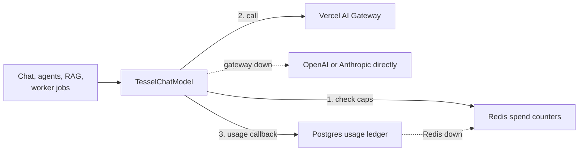

| Piece          | How it works                                                                                                                                                                             |
| -------------- | ---------------------------------------------------------------------------------------------------------------------------------------------------------------------------------------- |
| Model registry | `packages/ai/models.json`: models, prices per million tokens, capabilities, picker visibility, plan tier, emergency fallback target, and the default model for each role.                |
| Chat models    | `ai.chatModel(context, modelId)` returns a LangChain chat model for one user and workspace. It supports `invoke`, `stream`, tools, and structured output.                                |
| Embeddings     | `ai.embeddings(context)` returns LangChain embeddings through the gateway's `/embeddings` endpoint, in batches of 128.                                                                   |
| Spend caps     | Checked before every call: per user, per workspace, and for the whole service, per UTC day. A capped request returns 429 `daily_cost_cap_reached` with `Retry-After`.                    |
| Usage ledger   | One `usage_events` row per call: tokens, cost, route, status (`ok`, `error`, `aborted`, `blocked`), latency, request ID. Stopped calls are recorded with estimated tokens. Append-only.  |
| Moderation     | The latest user message is classified before the chat model sees it. A blocked message returns 422 `content_blocked` and is recorded with status `blocked`.                              |
| Fallback       | Network errors, 5xx, 429, and gateway account errors retry once on the gateway, then go straight to the provider if a fallback key is set. The ledger records which route served a call. |
| Testing        | `@tessel/ai/testing` has a mock gateway (OpenAI-compatible, streaming, tool calls, embeddings) used by unit, API, and end-to-end tests. `pnpm --filter @tessel/ai mock-gateway` runs it. |

Endpoints: `GET /models` (picker list, no prices); `POST /workspaces/:workspaceId/completions` (one non-streaming reply; streaming chat arrives in step 6); `GET /workspaces/:workspaceId/usage?days=30` (owners and admins see the workspace, members see their own usage).

## Chat

| Piece       | How it works                                                                                                                                                                                                                       |
| ----------- | ---------------------------------------------------------------------------------------------------------------------------------------------------------------------------------------------------------------------------------- |
| Data        | `threads`, `messages`, and `attachments`, private to the member who started the thread (row-level security in `0003_chat.sql`).                                                                                                    |
| Sending     | `POST /workspaces/:workspaceId/chat` with `{ threadId?, model?, content, attachmentIds }`. All checks run first; then the user message and an empty assistant message (status `streaming`) are saved and the stream opens.         |
| Events      | `start` (thread, saved user message, assistant message ID), `token` (text), `done` (saved reply), `title` (new threads only), or `error` (saved failed reply). A comment every 15 seconds keeps proxies from closing idle streams. |
| Context     | The system prompt plus the newest messages that fit (up to 40 messages and 400k characters). Failed replies are left out; stopped replies stay.                                                                                    |
| Stopping    | The client aborts the request. The reply is saved as `stopped` with the text the user saw.                                                                                                                                         |
| Titles      | After the first reply, the utility model names the thread (recorded as feature `title`), with the first words of the message as a fallback.                                                                                        |
| Attachments | `POST /workspaces/:workspaceId/attachments` (multipart `file`), then referenced by ID when sending. `GET …/attachments/:id/content` serves the file to its owner.                                                                  |
| Web         | Live replies sit in a Zustand store outside components, so a new chat keeps streaming while the page moves to its URL. Finished messages land in the TanStack Query cache for the thread.                                          |

Other endpoints: `GET /workspaces/:workspaceId/threads?before=` (newest first, paginated), `GET|PATCH|DELETE /workspaces/:workspaceId/threads/:threadId`.

## Knowledge (documents and search)

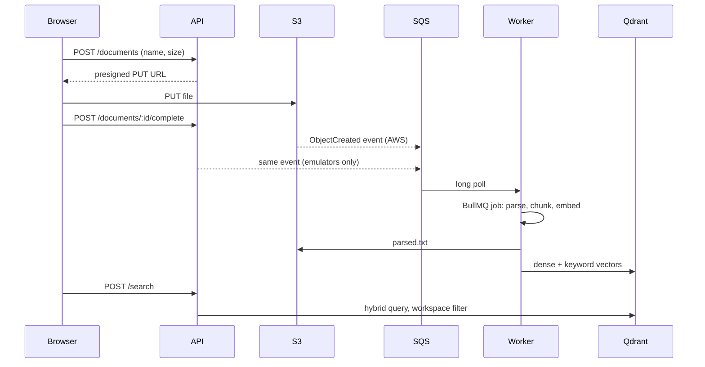

| Piece        | How it works                                                                                                                                                                                 |
| ------------ | -------------------------------------------------------------------------------------------------------------------------------------------------------------------------------------------- |
| Formats      | PDF (page by page), Word (.docx), text, Markdown, CSV, JSON, HTML. Up to 50 MB and about 2 million characters per document.                                                                  |
| Storage keys | `workspaces/{workspaceId}/documents/{documentId}/original` and `…/parsed.txt`; chat attachments at `workspaces/{workspaceId}/attachments/{id}`.                                              |
| Statuses     | `uploading` → `queued` → `processing` → `ready`, or `failed` with a reason the user can act on (`no_text`, `unreadable_file`, `daily_cost_cap_reached`, …). Failed documents can be retried. |
| Chunks       | About 1,500 characters with 200 of overlap, never crossing a page, each with its page number for citations.                                                                                  |
| Vectors      | Dense embeddings from the registry's embedding model, plus hashed keyword vectors weighted like BM25. Stored in one Qdrant collection with `workspace_id` as a tenant index.                 |
| Search       | `POST /workspaces/:workspaceId/search`: both vectors, fused with reciprocal rank fusion, filtered by workspace and optionally by document. Recorded in the ledger as feature `search`.       |
| Reliability  | SQS messages are deleted only after their job is queued; failing messages move to a dead-letter queue. Jobs retry three times with backoff, and re-running a job gives the same result.      |

### Answering from documents

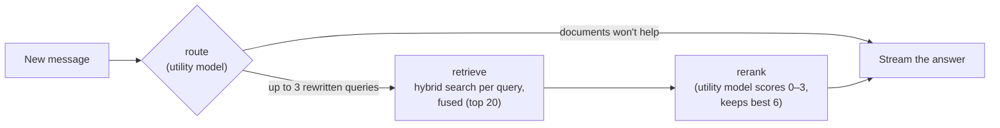

- Runs before the answer streams, as a LangGraph graph in `@tessel/ai` (`createRagPipeline`). The stream sends `status: searching`, then `sources`, then `status: writing`.
- The composer's documents setting chooses when to search: when it helps (the router decides), always, or never. Workspaces with nothing indexed skip search without any model call.
- The answer cites sources as `[n]`. Each reply is saved with its sources and which ones it cited (`messages.sources`).
- Router, query embeddings, and reranker are recorded in the ledger as feature `rag`.

Endpoints: `GET|POST /workspaces/:workspaceId/documents`, `GET|DELETE …/documents/:documentId`, `POST …/documents/:documentId/complete`, `POST …/documents/:documentId/reprocess`, `GET …/documents/:documentId/download`, `POST /workspaces/:workspaceId/search`.

### Graph RAG

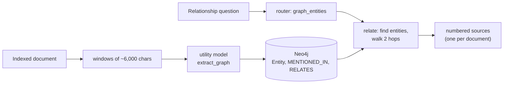

- `@tessel/graph` holds the Neo4j store, a memory store for tests, extraction, and fact formatting. The worker builds the graph after indexing; the API uses it in the RAG pipeline (`relate`), the `explore_graph` tool, and `GET /workspaces/:workspaceId/graph?entity=…`.
- The Documents page shows how many entities and connections were found, and lets you look up a name's connections.

## Chat extras

- **Versions.** Editing a message or retrying a reply keeps the chat from that message on as a version (`message_versions`, owner-only), and the message counts its versions (`messages.version_count`, `version_index`). `POST …/threads/:threadId/messages/:messageId/versions/:position/restore` keeps what's showing as a version in turn and brings the chosen one back; replies that were waiting come back stopped, and later messages' attachments aren't kept.
- **Skills from the composer.** Typing `/` lists the workspace's skills; the picked one goes with the message as `skill`, and its instructions are added to the system prompt for that reply, even for models without tools.
- **Mode suggestions.** The composer suggests Plan for a list of steps or a sequence, and Team for a mix of research, numbers, and writing (a heuristic in `lib/mode-suggestion.ts`); it never switches by itself.
- **Memory review.** A reply that saved a memory with `remember` says "Memory updated" under it, with Undo (the tool call carries `undo: { kind: "memory", id }`).

## Tools and approvals

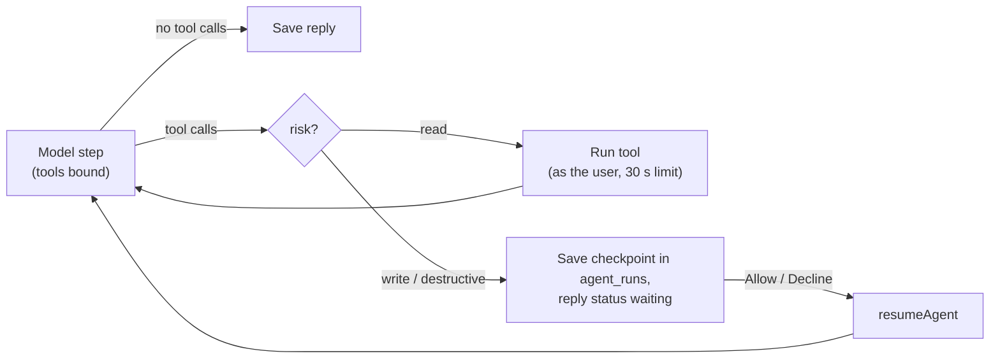

- The tool registry and ReAct loop live in `@tessel/ai` (`defineTool`, `runAgent`, `resumeAgent`); the API's workspace tools are in `chat.tools.ts`: search documents, list documents, create a document, delete a document, calculate, check the time.
- Tool calls stream as `tool` events and are saved on the reply (`messages.tool_calls`). Passages found by `search_documents` become citable sources like those from the RAG pipeline.
- A paused reply ends its stream with `done` status `waiting`. `POST /workspaces/:workspaceId/threads/:threadId/tool-calls/:callId/decision` with `{ approved }` claims the run and streams the rest of the reply, starting with `resume`.
- A new message in the chat cancels a waiting run. Runs are private to the chat's owner (row-level security on `agent_runs`).
- Model steps are recorded in the ledger as feature `chat`, like any other reply step, under the reply's spend caps.

## Agent modes

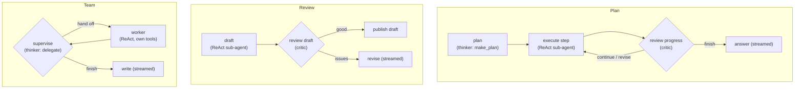

- `runOrchestrator` / `resumeOrchestrator` in `@tessel/ai` run the chosen mode; Answer mode is the step 9 agent. Each mode is a LangGraph graph over one JSON state, saved in `agent_runs` when a sub-agent pauses for approval.
- Team workers in chat: researcher (search and list documents), analyst (calculator, time), editor (create and delete documents, with approval).
- Stages stream as `activity` events and are saved on the reply (`messages.activity`, with `messages.agent_mode`). The interface shows them in a panel above the tool calls.
- Finished replies are moderated before they're saved; a blocked reply becomes an error (`reply_blocked`).

## Workspace policies

- `workspace_policies` (one row per workspace; members read it, owners and admins change it) holds tool policies, blocked connectors, and turned-off built-in skills. `GET`/`PUT /workspaces/:workspaceId/policies`; Settings shows it in team workspaces.
- Tool policies cover Tessel's own tools (`GOVERNABLE_TOOLS`): "ask" makes a tool wait for approval, "allow" lets it run without asking, "block" leaves it out of the agent's tools. Connector tools keep each connection's own settings.
- A blocked connector (by catalog ID, or name for custom servers) can't be connected, and existing connections to it drop out of the agent's tools.
- Owners and admins can turn built-in skills off for the workspace (`PATCH …/skills/builtin:<name>` with `{ enabled }`).
- **Skill files.** A workspace skill can carry up to 20 text files of up to 100 KB (`skill_files`; moderated like the skill). A loaded skill lists them, and `read_skill_file` reads one. `PUT …/skills/:id/files`, `GET …/files/content?path=`, `DELETE …/files?path=`.
- **Shared connectors.** An owner or admin can set up a connector for everyone (`shared`), with its credentials; members' agents use it, but only its creator changes it (row-level security lets members read shared rows).

## Skills

- A skill is a name, a description of when to use it, and instructions. Built-in skills are code in `@tessel/ai` (`builtInSkills`); workspace skills are rows in `skills`.
- Each reply lists enabled skills in the system prompt (`skillsPrompt`) and offers the `load_skill` tool, which returns a skill's instructions marked as instructions to follow (unlike other tool results, which are data).
- Endpoints: `GET|POST /workspaces/:workspaceId/skills`, `PATCH|DELETE …/skills/:skillId`. Saving moderates the text; names are unique per workspace and can't match a built-in one.
- The web app's Skills page lists workspace and built-in skills, with a switch to turn each workspace skill on or off.

## Connectors (MCP client)

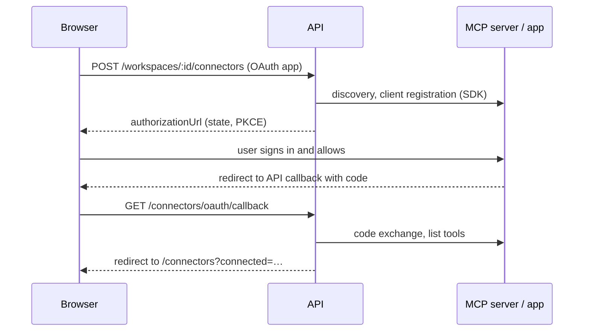

- `@tessel/mcp` holds the client (Streamable HTTP via the MCP SDK), the OAuth provider, credential encryption, the URL guard, the tool adapter, and a mock server for tests.
- Connections live in `connector_connections` (private to their user), with encrypted credentials, cached tools, and per-tool approval choices.
- Each reply adds the user's enabled connector tools (named like `github_create_issue`), opens a client per connector on first use, and closes them when the reply ends. In team mode an integrations specialist gets these tools.
- Endpoints: `GET|POST /workspaces/:workspaceId/connectors`, `POST …/connectors/:connectionId/refresh`, `PATCH|DELETE …/connectors/:connectionId`, and `GET /connectors/oauth/callback`.

## MCP server (Tessel for outside clients)

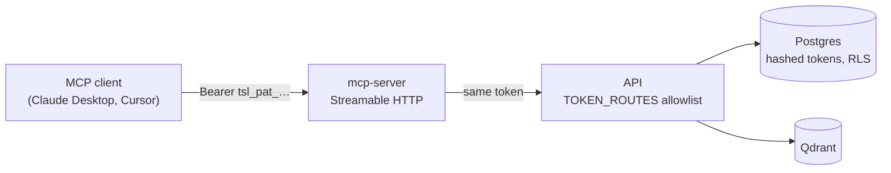

- Users create personal access tokens in Settings (`GET|POST /workspaces/:workspaceId/access-tokens`, `DELETE …/access-tokens/:tokenId`). The token is shown once, with the settings an MCP client needs.
- The API accepts a token only on allowlisted routes in its own workspace: listing and reading documents, document text (`GET …/documents/:documentId/text`), search, and `GET /access-tokens/current`.
- The MCP server (`@tessel/mcp/server`, run by `apps/mcp-server`) checks the token with the API, then serves `search_documents`, `list_documents`, and `read_document`, each a call to the API with the same token.
- Clients that support MCP authorization sign in instead of pasting a token:

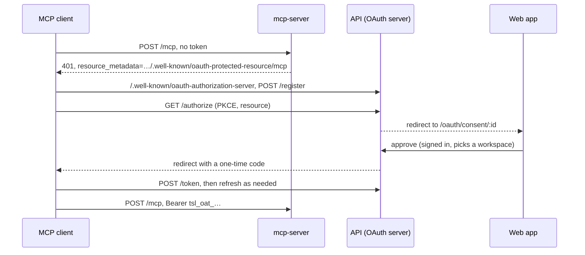

- The API is the authorization server, using the MCP SDK's router (`/register`, `/authorize`, `/token`, `/revoke`, metadata) with Tessel's own store. Clients register themselves; their registration is sealed with `ENCRYPTION_KEY`.
- Access tokens (`tsl_oat_`) last an hour and are stored like personal access tokens, so the same allowlist and workspace checks apply. Refresh tokens rotate on every use; reusing an old one ends the grant.
- Settings → Connected apps lists each client and disconnects it. Consent endpoints: `GET /oauth/authorizations/:authorizationId`, `POST …/approve`, `POST …/deny`; `GET|DELETE /users/me/connected-apps`.

## Memory

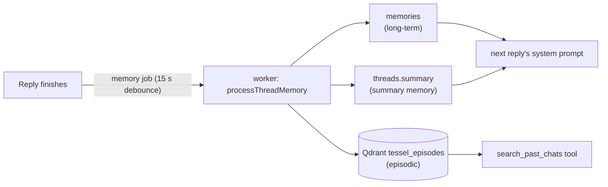

- `@tessel/memory` holds the store, the summarizer and extractor (utility model), the episode index, the memory tools, and `processThreadMemory`, which the worker runs for each `memory` job.
- Replies include up to 60 memories and the thread summary in the system prompt, and offer `remember` and `search_past_chats` when the user's settings allow.
- Endpoints: `GET /workspaces/:workspaceId/memory`, `PUT …/memory/settings`, `POST|DELETE …/memory/memories`, `PATCH|DELETE …/memory/memories/:memoryId`. Settings has a Memory section for all of it.

## Voice

```mermaid
sequenceDiagram
  participant B as Browser
  participant A as API
  participant L as LiveKit (rtc.)
  participant V as Voice agent
  B->>A: POST /workspaces/:id/voice/sessions
  A->>A: plan, spend cap, model; voice_sessions row
  A-->>B: room URL + token (agent dispatch in the room config)
  B->>L: join, publish microphone
  L->>V: dispatch job {voiceSessionId}
  V->>V: open session as its owner (RLS), load the chat
  loop each turn
    B-->>L: speech
    L-->>V: audio (16 kHz)
    V->>V: STT, end of turn, model, TTS
    V-->>L: speech (24 kHz)
    L-->>B: speech
  end
  V->>V: messages, turn timings, usage saved as they happen
```

- `apps/voice` is a LiveKit Agents server (`@livekit/agents`). LiveKit dispatches each room the API creates to it; it keeps warm job processes, so a call starts without spinning one up. The pipeline is speech to text, the chat model through the gateway, and text to speech, all streaming.
- Latency (target: under 600 ms from the end of speech to the first sound, p95 under 900 ms):
  - End of turn: voice activity detection plus LiveKit's audio end-of-turn model, both on-device (`inference.VAD`, `inference.TurnDetector`, native, weights included). Endpointing is dynamic (`VOICE_ENDPOINTING_MIN_MS`, 250 by default, to `VOICE_ENDPOINTING_MAX_MS`), so a confident end of turn commits fast and a trailing "um" waits.
  - The model starts on the transcript before the turn is confirmed (preemptive generation) and the draft is dropped if the user keeps talking.
  - Prompt caching is on, reasoning models run at the lowest effort, replies are short by instruction, and speech starts on the first sentence.
  - Every reply's end-of-turn, model first token, first audio, and total delay are saved in `voice_turns`, and p50 and p95 per session in `voice_sessions`.
- Speech: ElevenLabs directly when `ELEVENLABS_API_KEY` is set (Scribe v2 Realtime and Flash v2.5; also the only path for users' own voices), otherwise the same models through the AI gateway (`apps/voice/src/speech/gateway-*.ts`, the AI SDK's streaming speech).
- Voices: six ElevenLabs default voices, chosen in Settings → Voice (`users.voice_preference`), and on paid plans with ElevenLabs set up, the user's own voice (`user_voices`):
  - The user agrees, then reads a passage ending in a one-time code (signed with HMAC, valid ten minutes).
  - The API transcribes the recording (ElevenLabs Scribe), checks that the code words were said in order and that there are at least 15 seconds of speech, and only then creates an Instant Voice Clone. The recording isn't stored.
  - Recording again replaces the voice, deleting removes it at ElevenLabs too, and both are in the audit log (`voice.added`, `voice.removed`).
  - The API puts the provider voice ID on each session; the agent speaks with it (a cloned voice only through ElevenLabs directly, so without that key the default voice speaks). Previews come from ElevenLabs, or the gateway's speech for stock voices.
  - Endpoints under `…/voice/voices`: `GET`, `PUT selected`, `POST challenge`, `POST` (the recording as the body), `DELETE :voiceId`, `GET :voiceId/preview`.
- The model is the session's (the picker's choice, or the registry's `voice` default), with the same plan check as chat. The spend cap is checked before every reply; a capped user hears why and the call ends. Calls end at `VOICE_MAX_SESSION_MINUTES`.
- The agent knows what chat knows: the user's memories and the chat's running summary are in its instructions, `remember` saves a memory when asked, and `search_documents` runs the same hybrid search over the workspace's documents (with `QDRANT_URL` set). It says it's checking before a lookup, so a search never sounds like a stall.
- Outside voice mode, replies have **Read aloud** (`POST …/voice/speak`, the user's voice) and the composer has **Dictate** (`POST …/voice/transcribe`, ElevenLabs Scribe or `elevenlabs/scribe-v2` through the gateway); both are capped and recorded. Admin → Voice shows latency percentiles, the share within target, and the median per stage (`app.admin_voice_*`, migration 0024).
- What's said goes into the chat (`messages.voice_session_id` marks it), the first thing said names a new chat, and the memory job runs when the call ends. Usage rows (feature `voice`) cover model tokens, transcribed minutes, and spoken characters.
- The agent finds a session's owner through `app.voice_session_owner` (security definer, open sessions only) and does everything else as that user, so row-level security applies to it like to the API.
- Endpoints: `GET /workspaces/:workspaceId/voice/status`, `POST …/voice/sessions`, `POST …/voice/sessions/:sessionId/end`. Starting a session ends the user's other open ones.
- Tests: `apps/voice/test/conversation.test.ts` runs whole conversations through the real session, speech classes, gateway model client, and database, with scripted speech models and the mock gateway.

## Artifacts and apps

- The model writes substantial work inline as `<artifact id type title [language]>…</artifact>` (types `html`, `react`, `svg`, `mermaid`, `markdown`, `code`, `app`; the instructions are in `chat.history.ts`). `@tessel/contracts` parses replies into text and artifacts, including while they stream, so nothing new is stored: an artifact's versions are the chat's assistant messages that write the same id, and editing or retrying a message changes them the way it changes the chat.
- The web app shows a card in the reply and opens the artifact in a side panel (full screen on a phone): preview or code, versions, copy, download, run again. While an artifact is written its code streams; the preview runs once it's complete.
- Previews run in an `iframe` with `srcdoc` and `sandbox` without `allow-same-origin`, so the artifact has an opaque origin and can't reach the app's cookies, storage, or API. Errors inside are posted to the panel, which shows them.
- React components are compiled in the frame with Sucrase; React comes from esm.sh through an import map, other packages from esm.sh sharing that React, and Tailwind's browser build styles them. Mermaid renders with `securityLevel: "strict"`.
- An `app` artifact is a project of `<file path>` files. Its pages are its HTML files: local stylesheets and classic scripts are inlined, and module scripts go through a loader inside the frame that compiles each file, links relative imports (with or without extensions) as blob URLs, injects imported CSS, and turns JSON and SVG imports into modules. Links to the app's other pages open them in the panel. It downloads as a zip of its files (`fflate`).

## Images

- Chat has two tools when an image model is set up (`AI_IMAGE_MODEL`, through the gateway's AI SDK endpoint `AI_GATEWAY_SDK_URL`): `generate_image` (a prompt and an aspect ratio) and `edit_image` (a change, and the images to change: by ID, or by default the newest image in the chat). Team mode gets a designer worker with both. Image tools may run for up to three minutes.
- The model knows images by ID: attached images appear in the user's turn as `<attached_image id>`, images a reply made as `<generated_image id>` after it, and "Edit in chat" sends `[image:ID]` at the start of the message (shown as a thumbnail, not text).
- `media` holds every generated image and video: owner-only under row-level security, with the prompt, model, source images, size, and cost. The file is in S3 at `workspaces/{workspaceId}/media/{mediaId}/original`, with a 512 px WebP preview beside it (`sharp`). Sources are re-encoded as PNG (at most 2048 px) before they go to the model, and an edit keeps the source's shape unless asked otherwise.
- Tool calls carry `media` (kind, ID, size, alt text); the reply shows those images under its text, with a placeholder of the right shape while one is made. Images open full screen with download and "Edit in chat".
- Each generation checks the plan's limits and the daily caps, and is recorded as feature `image` at the gateway's reported cost (or by tokens, or a flat price per image). The gallery's prompts are moderated; in chat the user's message already was.
- The gallery (`/gallery`, "Images") lists them newest first, makes new ones, edits one into a new image, downloads, and deletes. Endpoints under `/workspaces/:workspaceId/media`: `GET /status`, `GET /`, `POST /images`, `GET /:mediaId`, `GET /:mediaId/content?variant=original|preview`, `DELETE /:mediaId`. Files are served with the user's token and cached as immutable.

## Videos

- `generate_video` (when `AI_VIDEO_MODEL` is set up) makes a 4, 6, or 8 second clip with sound, landscape or portrait, optionally from an image in the chat. It costs about a dollar, so it's a paid-plan feature and the user approves each one, like a write tool. The gallery's Videos tab starts them too (`POST /workspaces/:workspaceId/media/videos`).
- Starting a video calls the gateway's asynchronous video API (`experimental_startVideo`) and saves a `pending` row in `media` with the provider's operation handle, then queues a `video` job on the `media` queue.
- The worker checks the operation (`experimental_getVideoStatus`) every `VIDEO_POLL_MS`. While it's running, the row's progress moves toward 95% (providers don't report progress) and the job queues itself again. When it's done, the clip is saved to S3 and the row marked `ready`, with its cost recorded as feature `video`. Errors and anything over 15 minutes are marked `failed`.
- The reply and the gallery show the video's progress (they poll the item while it's pending), then a player with download.

## Document formats and uploads

- Besides PDF, Word, text, Markdown, CSV, JSON, and HTML, the worker reads Excel (.xlsx: every sheet, rows as tab-separated cells) and PowerPoint (.pptx: slides as pages, with speaker notes) straight from their XML.
- A PDF with no text layer is a scan: the worker sends it (up to 20 MB and 100 pages) to a model that reads PDFs (`AI_OCR_MODEL`, from the registry) and indexes its page-by-page transcription. Recorded as feature `ocr`.
- Files over `UPLOAD_MULTIPART_THRESHOLD_BYTES` (50 MB) go up in parts of `UPLOAD_PART_BYTES` (16 MB): the API starts an S3 multipart upload (`documents.upload_id`), presigns part URLs in batches (`POST …/documents/:id/parts`), and on `complete` joins the listed parts, so the browser never needs ETags. The browser sends four parts at once, retries each, and remembers the upload by file, so picking the same file again carries on from the parts that made it (`GET …/documents/:id/parts`). Deleting the document cancels the upload.
- The composer's documents menu can pick documents for the next messages: they're always searched, and the search tool stays within them (`documentIds` on the message).
- The Documents page draws an entity's neighbourhood from the knowledge graph as a diagram; choosing a neighbour moves to it, and a list view shows every connection.

## Recordings

- Audio (MP3, M4A, WAV, OGG, FLAC, AAC, Opus) and video (MP4, MOV, WebM, MKV) upload to Documents like any file, up to 500 MB, and are transcribed instead of parsed.
- The worker turns the recording into small mono speech audio with ffmpeg (16 kHz MP3, about 15 MB an hour; the worker image installs ffmpeg) and sends it to the gateway's transcription model (`AI_TRANSCRIPTION_MODEL`, default `elevenlabs/scribe-v2`). Without ffmpeg, the file goes as it is.
- The transcript is saved as the document's text in paragraphs of about a minute, each starting with its time ("[1:05] …"), then chunked, embedded, and indexed like any document. Search hits and citations quote the time, so an answer says where in the recording it came from.
- Transcription counts toward the uploader's daily caps and is recorded as feature `transcription` (minutes × `AI_TRANSCRIPTION_USD_PER_MINUTE`). Failures the user can act on mark the document failed with `transcription_failed` or `transcription_unavailable`.

## Caching

| Layer          | Where                     | Key                                                  | Lifetime                        |
| -------------- | ------------------------- | ---------------------------------------------------- | ------------------------------- |
| Embeddings     | Cache Redis               | model, dimensions, hash of text                      | 7 days                          |
| Search results | Cache Redis               | workspace, search version, hash of query vectors     | 10 minutes or the next re-index |
| Prompts        | Provider, via the gateway | automatic cache markers, session affinity per thread | the provider's (5 minutes)      |
| Model list     | Browser                   | `Cache-Control: private, max-age=300` and ETag       | 5 minutes, then revalidated     |

`withSearchCache` wraps the Qdrant index in both the API and the worker; the worker's writes bump the workspace's search version. All caches fail open.

## Background jobs

| Queue       | Job           | When                         | What it does                                                          |
| ----------- | ------------- | ---------------------------- | --------------------------------------------------------------------- |
| `documents` | `ingest`      | after an upload event        | parse, chunk, embed, and index a document                             |
| `memory`    | `thread`      | 15 s after a reply, per chat | summary, long-term, and episodic memory                               |
| `system`    | `maintenance` | daily at 03:17 UTC           | old tokens, unanswered approvals, old checkpoints, abandoned sign-ins |

## Billing

| Concern       | Approach                                                                                                                                                                                                                                                                        |
| ------------- | ------------------------------------------------------------------------------------------------------------------------------------------------------------------------------------------------------------------------------------------------------------------------------- |
| Plans         | `PLANS` in `@tessel/contracts`: Free, Pro ($20), Max ($100), and Team ($30 a seat, two seats or more). Each has a five-hour and a weekly limit in model cost, per person per workspace, and a model tier.                                                                       |
| State         | `billing_accounts` (one row per paying workspace: plan, status, provider, subscription, seats, period, extra usage), `usage_windows` (when each person's windows started), `extra_usage_requests` (requests billed as extra), and `billing_events` (webhook IDs already seen).  |
| Enforcement   | `createUsageLimits` runs before each chat and completion request: checks the model tier, then both windows against the usage ledger, then extra usage under its cap. A cancelled or unpaid plan counts as Free; a past-due one keeps its plan for 7 days after its period ends. |
| Payments      | `modules/billing/providers.ts`: Stripe (Checkout, Billing Portal, invoice items) and Razorpay (subscriptions, add-ons), both over `fetch`. Webhooks at `/billing/webhooks/stripe` and `/billing/webhooks/razorpay` are verified with the raw body before JSON parsing.          |
| Plan changes  | Only verified webhooks change a plan. Switching plans updates the existing subscription; team seats follow membership.                                                                                                                                                          |
| Extra usage   | Charged at cost when a period closes, on the renewal invoice (Stripe) or the next charge (Razorpay).                                                                                                                                                                            |
| Local and e2e | `pnpm --filter @tessel/api mock-payments` (port 4600) plays Stripe and Razorpay, with payment pages and signed webhooks. Set `PAYMENTS_MOCK_URL` to use it; production refuses it.                                                                                              |

## Web app

| Concern          | Approach                                                                                                                                                                                                                                                                                                                                                                        |
| ---------------- | ------------------------------------------------------------------------------------------------------------------------------------------------------------------------------------------------------------------------------------------------------------------------------------------------------------------------------------------------------------------------------- |
| Server data      | TanStack Query. Hooks and cache keys live in `@tessel/api-client/react`, so every page reads and invalidates data the same way.                                                                                                                                                                                                                                                 |
| UI state         | Zustand: the session (status, user, access token) and the last-opened workspace. Server data is never copied into Zustand.                                                                                                                                                                                                                                                      |
| HTTP             | One axios instance from `@tessel/api-client`. A request interceptor adds the access token; a response interceptor refreshes once on a 401 and retries. Concurrent 401s share a single refresh, a refresh that raced another tab is retried once, and only a rejected refresh (not a network error) signs the user out. Every response is validated against `@tessel/contracts`. |
| Access token     | Kept in memory only. On page load, the app exchanges the httpOnly refresh cookie for a new token.                                                                                                                                                                                                                                                                               |
| Route protection | Client-side gates (`RequireSession`, `GuestOnly`). The refresh cookie belongs to the API host, so the web server can't see it; the API is the real gate. `next` redirects only accept paths inside the app.                                                                                                                                                                     |
| Forms            | react-hook-form with the same Zod schemas the API uses. API field errors land on the matching input; other errors show at the top of the form.                                                                                                                                                                                                                                  |
| Streaming        | `fetch` with SSE for chat (`api.chat.send` in `@tessel/api-client`), since axios can't stream response bodies in the browser. It refreshes the token once on a 401, like axios.                                                                                                                                                                                                 |
| Design           | Tokens in `apps/web/app/globals.css` (Tailwind v4 `@theme`), with a matching dark palette. Fonts are bundled (Bricolage Grotesque for headings, Atkinson Hyperlegible Next for text). Shared components live in `@tessel/ui`.                                                                                                                                                   |
| Mobile           | The sidebar becomes a drawer below 768 px. Inputs use 16 px text so iOS doesn't zoom, tap targets are at least 44 px, and layouts use `dvh` and safe-area insets.                                                                                                                                                                                                               |

## Deployment

| Piece            | Where                                                                                                                                                                                                                              |
| ---------------- | ---------------------------------------------------------------------------------------------------------------------------------------------------------------------------------------------------------------------------------- |
| Images           | `infra/docker/node.Dockerfile` (api, worker, mcp-server, migrate, voice) and `infra/docker/web.Dockerfile`, built by `infra/scripts/build-images.sh`                                                                               |
| Web app          | Vercel, from `apps/web` on every push to `main` (previews for pull requests). It shares a site with the API so the `SameSite=Strict` sign-in cookie works                                                                          |
| Production stack | `infra/deploy/docker-compose.prod.yml` with profiles: apps (always), `web` (the web app, when not on Vercel), `edge` (Caddy + HTTPS), `data` (databases on the host), `voice` (LiveKit and the voice agent), `tools` (migrate job) |
| Deploy           | `.github/workflows/deploy.yml` runs after CI passes on `main`: build, push to ECR, run `infra/deploy/deploy.sh` on EC2 through SSM                                                                                                 |
| Secrets          | SSM Parameter Store under `/tessel/prod`, written to a root-only `.env` on each deploy                                                                                                                                             |
| Health           | Every service has a health check; deploys wait for all of them and roll back on failure                                                                                                                                            |
| Backups          | Nightly `pg_dump` and a Qdrant snapshot to S3 from a systemd timer when the databases run on the host (`infra/deploy/backup.sh`, `restore.sh`)                                                                                     |
| Logs             | With `LOG_GROUP` set, every container logs to CloudWatch through a Compose override written by `deploy.sh`; otherwise rotated local files                                                                                          |
| CI safety net    | Every pull request builds all production images and boots the full production stack (`infra/scripts/smoke-test.sh`) with S3 and SQS emulators, including a signup through the real API image                                       |

Setup steps: [infra/aws/README.md](../infra/aws/README.md).

## Conventions

- **Configuration:** Each app validates its environment with Zod at startup (`parseEnv`) and fails fast with every problem listed. Locally, `.env` at the repo root is loaded; in containers, variables come from the environment.
- **Errors:** Every error response has the shape `{ error: { code, message, requestId?, details? } }`.
- **Health:** Services expose `GET /health` (liveness). The API also exposes `GET /health/ready`, which checks every dependency with a timeout and returns 503 if any is down. Dependency error details are hidden in production.
- **Logging:** Structured JSON through `@tessel/logger`. Passwords, tokens, API keys, and auth headers are redacted.
- **Shutdown:** Apps close servers, workers, and connections on `SIGTERM` before exiting, with a forced exit after a timeout.
- **Jobs:** Queue names and payload schemas live in `@tessel/queue`. Workers validate payloads; bad input fails without retries.
- **Imports:** Workspace packages are imported by name (`@tessel/db`), never by relative path across packages.

## Security baseline

Built into each step as it lands; deep security testing comes after phase 1.

- Passwords hashed with Argon2id, short-lived access tokens, rotating refresh tokens with reuse detection (built in step 2).
- Membership checks on every tenant query, plus Postgres row-level security per workspace (built in step 2).
- Rate limits on every route, with stricter limits on auth routes (built in step 2).
- Workspace filters on every Qdrant and Neo4j query, and workspace-prefixed S3 keys.
- Moderation of user input before any chat model sees it (built in step 5); output moderation and prompt-injection checks on messages and uploaded documents.
- Daily spend caps per user, workspace, and service, and an append-only usage ledger for every model call (built in step 5).
- Retrieved documents, tool results, and MCP results are treated as data, never instructions.
- Workspace and user IDs come from the session, never from the model or tool arguments.
- Write and destructive tools require approval; every tool has a timeout and a call limit.
- Secrets live in AWS SSM Parameter Store in production, never in code or images.
