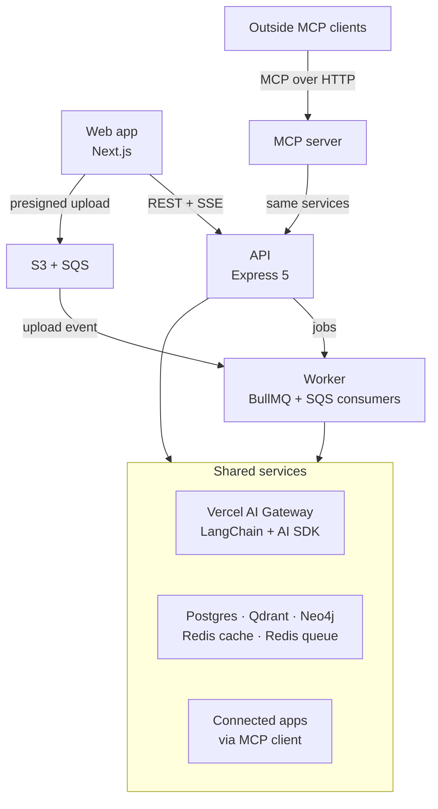

# Architecture

Tessel is an AI workspace for teams: chat over their own documents, agents that use tools and ask before risky actions, and outside apps connected through MCP. This document describes how the system is put together and the rules every part follows.

## System overview

- The web app talks only to the API. Files go straight from the browser to S3.
- Anything slow (ingestion, long agent runs, memory extraction) runs in the worker.
- Every model call goes through `packages/ai` and the Vercel AI Gateway; nothing calls a provider directly.

## Apps

| App               | Purpose                                                               |
| ----------------- | --------------------------------------------------------------------- |
| `apps/web`        | Next.js user app: chat, uploads, approvals, settings                  |
| `apps/api`        | Express 5 API, split into feature modules                             |
| `apps/worker`     | Background jobs (BullMQ) and S3 upload events (SQS)                   |
| `apps/mcp-server` | Exposes workspace search and actions to outside MCP clients           |
| `apps/admin`      | Admin app for users, models, usage, and audit logs (added in step 18) |

## Packages

Workspace packages export TypeScript source directly. Apps compile them as part of their own build (Next.js through `transpilePackages`, Node apps through `tsdown`), so there is no separate package build step.

| Package              | Purpose                                              | Added   |
| -------------------- | ---------------------------------------------------- | ------- |
| `@tessel/config`     | Shared tsconfig presets, env loading and validation  | Step 1  |
| `@tessel/logger`     | Structured logging with secret redaction             | Step 1  |
| `@tessel/contracts`  | Zod schemas and types shared by frontend and backend | Step 1  |
| `@tessel/db`         | Drizzle schema, migrations, database client          | Step 1  |
| `@tessel/queue`      | Queue names, job payload schemas, Redis connection   | Step 1  |
| `@tessel/api-client` | axios instance and TanStack Query hooks              | Step 3  |
| `@tessel/ui`         | Shared UI components                                 | Step 3  |
| `@tessel/ai`         | Gateway client, model registry, prompts, graphs, RAG | Step 5  |
| `@tessel/tools`      | Built-in tools and the tool registry                 | Step 9  |
| `@tessel/skills`     | Built-in skills                                      | Step 11 |

## Data stores

| Store       | Holds                                                                                                        |
| ----------- | ------------------------------------------------------------------------------------------------------------ |
| Postgres    | Source of truth: users, workspaces, threads, messages, documents, usage, agent checkpoints, long-term memory |
| Qdrant      | Chunk and memory vectors (dense + sparse), always filtered by workspace                                      |
| Neo4j       | Entities and relationships for graph RAG, always filtered by workspace                                       |
| Redis cache | Caching, rate limits, live run events. Evicts least-recently-used keys                                       |
| Redis queue | BullMQ only. Never evicts, persists to disk                                                                  |
| S3          | Original files, parsed text, artifacts. Keys start with the workspace ID                                     |

The two Redis instances are separate on purpose: a cache must be allowed to evict, and a queue must never lose jobs.

## API module pattern

Each feature in `apps/api/src/modules/<name>/` follows the same layout:

| File              | Job                                                 |
| ----------------- | --------------------------------------------------- |
| `*.routes.ts`     | Routes and the middleware chain                     |
| `*.controller.ts` | Reads the request, sends the response, nothing else |
| `*.service.ts`    | Business logic                                      |
| `*.repository.ts` | Database access                                     |
| `*.schemas.ts`    | Zod schemas, re-exported from `@tessel/contracts`   |
| `*.policy.ts`     | Who can do what                                     |
| `*.test.ts`       | Integration tests                                   |

Every request passes through, in order: request ID, request logging, security headers (helmet), CORS, body parsing (1 MB limit), rate limiting, authentication, Zod validation, permission check, controller, and one shared error handler.

Modules are wired in `apps/api/src/app.ts`: each one exposes factory functions (`createXService`, `createXController`, `createXRouter`), so tests can build the whole app against a test database with cheaper settings.

## Authentication

| Piece           | How it works                                                                                                                                                                                          |
| --------------- | ----------------------------------------------------------------------------------------------------------------------------------------------------------------------------------------------------- |
| Passwords       | Argon2id (19 MiB, 2 iterations). Unknown emails still run a dummy verification so timing doesn't reveal which accounts exist.                                                                         |
| Access token    | JWT (HS256), 15 minutes, sent as `Authorization: Bearer`. Carries the user ID and role. Stateless.                                                                                                    |
| Refresh token   | 256-bit random value in an httpOnly, `SameSite=Strict`, `Path=/auth` cookie. Stored only as a SHA-256 hash.                                                                                           |
| Rotation        | Every refresh retires the presented token and issues a new one in the same family (one family = one login session).                                                                                   |
| Reuse detection | Presenting a retired token revokes the whole family. A token rotated less than 10 seconds earlier returns `refresh_token_rotated` instead, because that is almost always two tabs refreshing at once. |
| Password change | Revokes every session for the user and starts a new one.                                                                                                                                              |
| CSRF            | Auth routes reject browser requests whose `Origin` is not an allowed web origin, on top of `SameSite=Strict`.                                                                                         |

Endpoints: `POST /auth/signup`, `/auth/login`, `/auth/refresh`, `/auth/logout`; `GET /users/me`; `POST /users/me/password`; `GET|POST /workspaces`; `GET|PATCH /workspaces/:workspaceId`.

## Tenant isolation

Workspaces are the tenant boundary. Isolation is enforced twice:

1. **In code:** tenant queries join on the caller's membership, and services return 404 (never 403) for workspaces the caller doesn't belong to, so their existence isn't revealed.
2. **In Postgres:** row-level security policies on tenant tables (see `packages/db/migrations/0001_row_level_security.sql`). The API connects as the restricted `tessel_app` role, which neither owns the tables nor bypasses RLS. Each request's tenant work runs in `withUserContext(db, userId, …)`, a transaction that sets `app.user_id`; without it, tenant tables return nothing.

| Role                                      | Purpose                                                                                                                      |
| ----------------------------------------- | ---------------------------------------------------------------------------------------------------------------------------- |
| Database owner (`DATABASE_MIGRATION_URL`) | Runs migrations. Never used by the running API.                                                                              |
| `tessel_app` (`DATABASE_URL`)             | The API's runtime role. RLS always applies. Its login and password are set by `pnpm db:migrate`, never stored in migrations. |

`users` and `refresh_tokens` are not tenant-scoped (auth reads them before any user context exists), so access to them is enforced in application code.

## Rate limiting

Counters live in the cache Redis, so limits hold across API instances. If Redis is down, limiting fails open after a 250 ms timeout rather than taking the API down.

| Limiter                         | Default           | Key               |
| ------------------------------- | ----------------- | ----------------- |
| All routes except health checks | 300 per minute    | IP                |
| Signup                          | 10 per hour       | IP                |
| Login                           | 10 per 15 minutes | IP + hashed email |
| Refresh                         | 30 per minute     | IP                |
| Password change                 | 5 per 15 minutes  | IP + user         |

## Conventions

- **Configuration:** Each app validates its environment with Zod at startup (`parseEnv`) and fails fast with every problem listed. Locally, `.env` at the repo root is loaded; in containers, variables come from the environment.
- **Errors:** Every error response has the shape `{ error: { code, message, requestId?, details? } }`.
- **Health:** Services expose `GET /health` (liveness). The API also exposes `GET /health/ready`, which checks every dependency with a timeout and returns 503 if any is down. Dependency error details are hidden in production.
- **Logging:** Structured JSON through `@tessel/logger`. Passwords, tokens, API keys, and auth headers are redacted.
- **Shutdown:** Apps close servers, workers, and connections on `SIGTERM` before exiting, with a forced exit after a timeout.
- **Jobs:** Queue names and payload schemas live in `@tessel/queue`. Workers validate payloads; bad input fails without retries.
- **Imports:** Workspace packages are imported by name (`@tessel/db`), never by relative path across packages.

## Security baseline

Built into each step as it lands; deep security testing comes after phase 1.

- Passwords hashed with Argon2id, short-lived access tokens, rotating refresh tokens with reuse detection (built in step 2).
- Membership checks on every tenant query, plus Postgres row-level security per workspace (built in step 2).
- Rate limits on every route, with stricter limits on auth routes (built in step 2).
- Workspace filters on every Qdrant and Neo4j query, and workspace-prefixed S3 keys.
- Moderation on input and output, prompt-injection checks on messages and uploaded documents.
- Retrieved documents, tool results, and MCP results are treated as data, never instructions.
- Workspace and user IDs come from the session, never from the model or tool arguments.
- Write and destructive tools require approval; every tool has a timeout and a call limit.
- Secrets live in AWS Secrets Manager in production, never in code or images.
