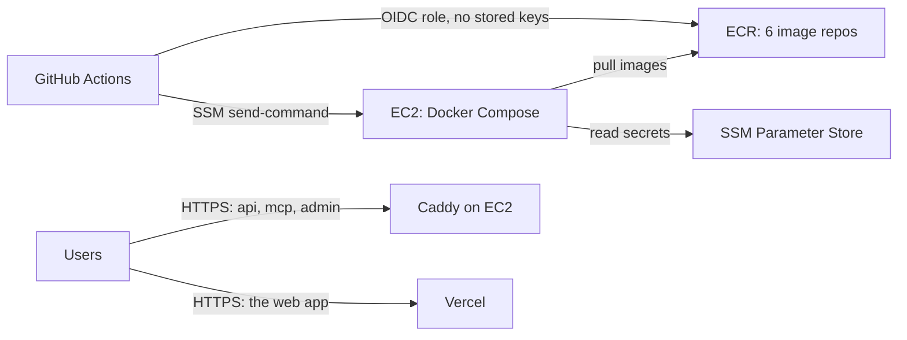
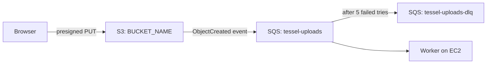

# AWS setup

One-time setup for automatic deploys. After this, every push to `main` that passes CI builds the images, pushes them to ECR, and deploys them to one EC2 host. The web app runs on Vercel (see [Web app on Vercel](#web-app-on-vercel)); the API, MCP server, admin app, and worker run on EC2.



Commands use `ap-south-1` (Mumbai) and placeholder IDs. Replace `ACCOUNT_ID`, `REGION`, `INSTANCE_ID`, `BUCKET_NAME`, and `BACKUP_BUCKET_NAME` everywhere, including in the policy files in `iam/`. Bucket names are global, so pick your own (for example `tessel-files-yourcompany`).

## 1. Image repositories

```bash
for repo in api worker mcp-server web admin migrate voice; do
  aws ecr create-repository --region ap-south-1 --repository-name "tessel-$repo" \
    --image-scanning-configuration scanOnPush=true
done
```

The `tessel-web` repository is only used when the web app runs on EC2 (the `web` profile), and `tessel-voice` with the `voice` profile. Optional: add a lifecycle policy to each repository to keep only the last 30 images.

## 2. File storage and upload events

Uploads go from the browser straight to S3. S3 then puts an event on an SQS queue, and the worker picks it up and indexes the document.



1. Create the files bucket, private and encrypted:
   ```bash
   aws s3api create-bucket --region ap-south-1 --bucket BUCKET_NAME \
     --create-bucket-configuration LocationConstraint=ap-south-1
   aws s3api put-public-access-block --bucket BUCKET_NAME \
     --public-access-block-configuration BlockPublicAcls=true,IgnorePublicAcls=true,BlockPublicPolicy=true,RestrictPublicBuckets=true
   aws s3api put-bucket-encryption --bucket BUCKET_NAME \
     --server-side-encryption-configuration '{"Rules":[{"ApplyServerSideEncryptionByDefault":{"SSEAlgorithm":"AES256"}}]}'
   ```
2. Let the web app upload to it (replace the origin with your web domain):
   ```bash
   aws s3api put-bucket-cors --bucket BUCKET_NAME --cors-configuration '{
     "CORSRules": [{ "AllowedOrigins": ["https://app.example.com"], "AllowedMethods": ["PUT", "GET"],
                     "AllowedHeaders": ["*"], "ExposeHeaders": ["ETag"], "MaxAgeSeconds": 3600 }]
   }'
   ```
3. Create the queue and its dead-letter queue. Messages that fail five times move to the dead-letter queue instead of retrying forever:
   ```bash
   aws sqs create-queue --region ap-south-1 --queue-name tessel-uploads-dlq \
     --attributes MessageRetentionPeriod=1209600
   aws sqs create-queue --region ap-south-1 --queue-name tessel-uploads --attributes '{
     "VisibilityTimeout": "60",
     "RedrivePolicy": "{\"deadLetterTargetArn\":\"arn:aws:sqs:ap-south-1:ACCOUNT_ID:tessel-uploads-dlq\",\"maxReceiveCount\":\"5\"}"
   }'
   ```
4. Allow the bucket to send events to the queue, then turn the events on for uploaded originals only:
   ```bash
   aws sqs set-queue-attributes --region ap-south-1 \
     --queue-url https://sqs.ap-south-1.amazonaws.com/ACCOUNT_ID/tessel-uploads \
     --attributes '{"Policy": "{\"Statement\":[{\"Effect\":\"Allow\",\"Principal\":{\"Service\":\"s3.amazonaws.com\"},\"Action\":\"sqs:SendMessage\",\"Resource\":\"arn:aws:sqs:ap-south-1:ACCOUNT_ID:tessel-uploads\",\"Condition\":{\"ArnEquals\":{\"aws:SourceArn\":\"arn:aws:s3:::BUCKET_NAME\"}}}]}"}'
   aws s3api put-bucket-notification-configuration --bucket BUCKET_NAME --notification-configuration '{
     "QueueConfigurations": [{
       "QueueArn": "arn:aws:sqs:ap-south-1:ACCOUNT_ID:tessel-uploads",
       "Events": ["s3:ObjectCreated:*"],
       "Filter": { "Key": { "FilterRules": [{ "Name": "prefix", "Value": "workspaces/" },
                                            { "Name": "suffix", "Value": "/original" }] } }
     }]
   }'
   ```
5. Optional, for databases on the host: a backups bucket that keeps 30 days of nightly Postgres and search index backups.
   ```bash
   aws s3api create-bucket --region ap-south-1 --bucket BACKUP_BUCKET_NAME \
     --create-bucket-configuration LocationConstraint=ap-south-1
   aws s3api put-public-access-block --bucket BACKUP_BUCKET_NAME \
     --public-access-block-configuration BlockPublicAcls=true,IgnorePublicAcls=true,BlockPublicPolicy=true,RestrictPublicBuckets=true
   aws s3api put-bucket-lifecycle-configuration --bucket BACKUP_BUCKET_NAME --lifecycle-configuration '{
     "Rules": [{ "ID": "expire-postgres", "Status": "Enabled", "Filter": { "Prefix": "postgres/" },
                 "Expiration": { "Days": 30 } },
               { "ID": "expire-qdrant", "Status": "Enabled", "Filter": { "Prefix": "qdrant/" },
                 "Expiration": { "Days": 7 } }]
   }'
   ```

## 3. Email (Amazon SES)

Tessel emails signup codes, password reset links, and security notices through SES.

1. Verify your domain so mail can come from it (replace `example.com`):
   ```bash
   aws sesv2 create-email-identity --region ap-south-1 --email-identity example.com
   ```
   The output lists three DKIM `CNAME` records. Add them to your DNS; SES marks the domain verified within about an hour. Check with:
   ```bash
   aws sesv2 get-email-identity --region ap-south-1 --email-identity example.com \
     --query VerifiedForSendingStatus
   ```
2. New SES accounts can only send to verified addresses. Ask AWS to lift that (production access):
   ```bash
   aws sesv2 put-account-details --region ap-south-1 --production-access-enabled \
     --mail-type TRANSACTIONAL --website-url https://app.example.com \
     --use-case-description "Account emails for Tessel users: sign-up codes, password resets, and security notices. Users only get mail for actions they take."
   ```
   Approval usually takes a day. Until then, verify your own address with `create-email-identity` to test.
3. Set `MAIL_FROM` to an address on the verified domain, such as `Tessel <no-reply@example.com>` (section 5).

The instance role's `SendEmail` statement only allows mail from identities in this account.

4. Stop mailing addresses that bounce or complain. SES keeps an account-level suppression list and skips those addresses from then on, which protects your sending reputation:
   ```bash
   aws sesv2 put-account-suppression-attributes --region ap-south-1 \
     --suppressed-reasons BOUNCE COMPLAINT
   ```
   Review it with `aws sesv2 list-suppressed-destinations`, and remove an address someone fixed with `delete-suppressed-destination`.

### Optional: Google and GitHub sign-in

"Continue with Google" and "Continue with GitHub" appear once their OAuth apps are set (section 5). Each callback URL is on the API domain.

- **Google:** in Google Cloud Console, open **APIs & Services → Credentials → Create credentials → OAuth client ID**, type **Web application**. Authorized redirect URI: `https://api.example.com/auth/oauth/google/callback`. Configure the consent screen with the scopes `openid`, `email`, and `profile`, and publish it. Store `GOOGLE_CLIENT_ID` and `GOOGLE_CLIENT_SECRET`.
- **GitHub:** in **Settings → Developer settings → OAuth Apps → New OAuth App**, set the callback URL to `https://api.example.com/auth/oauth/github/callback`. Store `GITHUB_CLIENT_ID` and `GITHUB_CLIENT_SECRET`. This is a different app from the GitHub connector's (`GITHUB_MCP_CLIENT_ID`).

### Optional: sign-in by text message (Amazon SNS)

Phone sign-in stays hidden until `SMS_TRANSPORT=sns` is set.

1. Attach [`iam/ec2-sms-policy.json`](iam/ec2-sms-policy.json) to the `tessel-ec2` role as a second inline policy. It allows texting phone numbers and nothing else (publishing to topics is denied).
2. New accounts are in the SMS sandbox, which only texts verified numbers. In the SNS console, open **Text messaging (SMS)** and request production access, and raise the monthly spending limit from its 1 USD default.
3. Indian numbers need DLT registration: register your business and a template such as `{#var#} is your Tessel sign-in code. It expires in 10 minutes. Don't share it.`, then store `SMS_DLT_ENTITY_ID`, `SMS_DLT_TEMPLATE_ID`, and the registered `SMS_SENDER_ID`. Tessel sends two texts (sign-in and confirming a number); register both wordings from `apps/api/src/lib/sms.ts`.

### Optional: payments (Stripe and Razorpay)

Upgrades appear once a provider's keys are stored (section 5). Without any, everyone stays on Free. Offer one or both: Stripe for cards worldwide, Razorpay for UPI and Indian cards.

- **Stripe:** in the dashboard, create three products with monthly recurring prices in USD: Pro ($20), Max ($100), and Team ($30, per unit). Store their price IDs as `STRIPE_PRICE_PRO`, `STRIPE_PRICE_MAX`, and `STRIPE_PRICE_TEAM`. Under **Developers → Webhooks**, add the endpoint `https://api.example.com/billing/webhooks/stripe` with the events `customer.subscription.created`, `customer.subscription.updated`, `customer.subscription.deleted`, and `invoice.created`, and store its signing secret as `STRIPE_WEBHOOK_SECRET`. Turn on the **Customer portal** (Settings → Billing → Customer portal) with plan cancellation and payment method updates. Store the secret key as `STRIPE_SECRET_KEY`. For yearly billing, add yearly prices to the same products (Pro $200, Max $1,000, Team $300 per unit) and store them as `STRIPE_PRICE_PRO_YEARLY`, `STRIPE_PRICE_MAX_YEARLY`, and `STRIPE_PRICE_TEAM_YEARLY`; Tessel bills a yearly plan's extra usage on its own invoice each month. For GST invoices, add your GSTIN under **Settings → Tax details** and turn on invoice PDFs; customers' GSTINs come from checkout or Settings in Tessel.
- **Razorpay:** under **Subscriptions → Plans**, create three monthly plans in INR: Pro (₹1,950), Max (₹9,750), and Team (₹2,900, charged per quantity). Store their IDs as `RAZORPAY_PLAN_PRO`, `RAZORPAY_PLAN_MAX`, and `RAZORPAY_PLAN_TEAM`. Under **Settings → Webhooks**, add `https://api.example.com/billing/webhooks/razorpay` with the `subscription.*` events and a secret, stored as `RAZORPAY_WEBHOOK_SECRET`. Store the API key pair as `RAZORPAY_KEY_ID` and `RAZORPAY_KEY_SECRET`. Extra usage is converted to rupees at `RAZORPAY_USD_TO_INR` (default 85). For yearly billing, create yearly plans too (Pro ₹19,500, Max ₹97,500, Team ₹29,000 per quantity) and store them as `RAZORPAY_PLAN_PRO_YEARLY`, `RAZORPAY_PLAN_MAX_YEARLY`, and `RAZORPAY_PLAN_TEAM_YEARLY`; extra usage needs monthly billing with Razorpay. For GST invoices, turn on **Subscriptions → Invoices** with your GSTIN in **Account & Settings → GST details**; Tessel creates each customer with the business's name and GSTIN.

Test with each provider's test-mode keys first; a test card payment should move the workspace to Pro in Settings within a few seconds.

## 4. EC2 host

1. Create an IAM role for EC2 named `tessel-ec2` with:
   - the managed policy `AmazonSSMManagedInstanceCore` (lets deploys reach the host without SSH)
   - an inline policy from [`iam/ec2-instance-policy.json`](iam/ec2-instance-policy.json) (pull images, read `/tessel/prod/*` secrets, use the files bucket and upload queue, write backups)
2. Launch an instance:
   - Amazon Linux 2023, `t3.large` or larger (8 GB of memory runs the apps and every database). Use `t3.medium` if databases are managed elsewhere.
   - 40 GB gp3 disk.
   - Instance profile: `tessel-ec2`.
   - Security group: allow inbound 80 and 443 from anywhere. No SSH port is needed. With the `voice` profile, also 7881/tcp and 7882/udp from anywhere: the audio of voice calls goes straight to LiveKit on these ports (UDP, or TCP where a network blocks UDP).
     ```bash
     aws ec2 authorize-security-group-ingress --group-id SG_ID --ip-permissions \
       'IpProtocol=tcp,FromPort=7881,ToPort=7881,IpRanges=[{CidrIp=0.0.0.0/0}]' \
       'IpProtocol=udp,FromPort=7882,ToPort=7882,IpRanges=[{CidrIp=0.0.0.0/0}]'
     ```
   - User data: the contents of [`bootstrap-ec2.sh`](bootstrap-ec2.sh).
   - Advanced details → Metadata response hop limit: **2**. The apps run in containers, one network hop further from the instance metadata service than the host; with the default of 1 they can't get the instance role's credentials. For an existing instance:
     ```bash
     aws ec2 modify-instance-metadata-options --instance-id INSTANCE_ID \
       --http-tokens required --http-put-response-hop-limit 2
     ```
3. Attach an Elastic IP so the address survives restarts.
4. Optional but recommended: a CloudWatch log group for every container's logs, kept for 30 days. Set `LOG_GROUP` (section 7) to use it.
   ```bash
   aws logs create-log-group --region ap-south-1 --log-group-name /tessel/prod
   aws logs put-retention-policy --region ap-south-1 --log-group-name /tessel/prod --retention-in-days 30
   ```
   Each container gets its own stream named after it, such as `tessel-api-1`. Read them under **CloudWatch → Log groups**, or with `aws logs tail /tessel/prod --follow`.
5. Point DNS `A` records at the Elastic IP: `app.`, `api.`, `mcp.`, and `admin.` on your domain, and `rtc.` with the `voice` profile. Caddy requests HTTPS certificates for them on first start.

## 5. Secrets

Every app secret is an SSM `SecureString` under `/tessel/prod`. [`../deploy/secrets.example`](../deploy/secrets.example) lists each one. For example:

```bash
put() { aws ssm put-parameter --region ap-south-1 --type SecureString --overwrite --name "/tessel/prod/$1" --value "$2"; }
put JWT_ACCESS_SECRET "$(openssl rand -base64 48)"
put ENCRYPTION_KEY "$(openssl rand -base64 32)"
put API_PUBLIC_URL "https://api.example.com"
put MCP_PUBLIC_URL "https://mcp.example.com"
put WEB_ORIGIN "https://app.example.com,https://admin.example.com"
put MAIL_FROM "Tessel <no-reply@example.com>"
put S3_BUCKET "BUCKET_NAME"
put SQS_UPLOADS_QUEUE_URL "https://sqs.ap-south-1.amazonaws.com/ACCOUNT_ID/tessel-uploads"
put AI_GATEWAY_API_KEY "<your Vercel AI Gateway key>"
# Voice (the voice profile): one key pair for LiveKit, the API, and the agent.
put LIVEKIT_API_KEY "API$(openssl rand -hex 6)"
put LIVEKIT_API_SECRET "$(openssl rand -base64 32)"
put LIVEKIT_URL "http://livekit:7880"
put LIVEKIT_PUBLIC_URL "wss://rtc.example.com"
# ...and the rest from secrets.example
```

`deploy.sh` writes them to `/opt/tessel/.env` on each deploy (readable only by root).

## 6. GitHub deploy role

1. Add GitHub as an identity provider (once per AWS account):
   ```bash
   aws iam create-open-id-connect-provider \
     --url https://token.actions.githubusercontent.com \
     --client-id-list sts.amazonaws.com
   ```
2. Create a role named `tessel-github-deploy`:
   - trust policy: [`iam/github-oidc-trust-policy.json`](iam/github-oidc-trust-policy.json) (only this repo's `production` environment can assume it)
   - inline policy: [`iam/github-deploy-policy.json`](iam/github-deploy-policy.json) (push to `tessel-*` repos, run commands on this one instance)

## 7. GitHub variables

In the repository, open **Settings → Secrets and variables → Actions → Variables** and add:

| Variable              | Example                                                                                                                                             |
| --------------------- | --------------------------------------------------------------------------------------------------------------------------------------------------- |
| `AWS_REGION`          | `ap-south-1`                                                                                                                                        |
| `AWS_DEPLOY_ROLE_ARN` | `arn:aws:iam::123456789012:role/tessel-github-deploy`                                                                                               |
| `ECR_REGISTRY`        | `123456789012.dkr.ecr.ap-south-1.amazonaws.com`                                                                                                     |
| `EC2_INSTANCE_ID`     | `i-0abc123def4567890`                                                                                                                               |
| `WEB_DOMAIN`          | `app.example.com` (the web app, served by Vercel)                                                                                                   |
| `API_DOMAIN`          | `api.example.com`                                                                                                                                   |
| `MCP_DOMAIN`          | `mcp.example.com`                                                                                                                                   |
| `ADMIN_DOMAIN`        | `admin.example.com`                                                                                                                                 |
| `ACME_EMAIL`          | `you@example.com` (Let's Encrypt expiry notices)                                                                                                    |
| `RTC_DOMAIN`          | `rtc.example.com` (LiveKit, for voice; needed with the `voice` profile)                                                                             |
| `COMPOSE_PROFILES`    | `edge,data,voice` (drop `data` with RDS and ElastiCache; add `web` to serve the web app from EC2 instead of Vercel; drop `voice` to turn voice off) |
| `IMAGE_PLATFORM`      | optional: `linux/arm64` for Graviton instances such as `t4g`                                                                                        |
| `BACKUP_BUCKET`       | optional: `BACKUP_BUCKET_NAME` for nightly backups                                                                                                  |
| `LOG_GROUP`           | optional: `/tessel/prod` to send logs to CloudWatch                                                                                                 |

None of these are secret. Deploys stay off until `AWS_DEPLOY_ROLE_ARN` is set.

## 8. First deploy

Run the **Deploy** workflow from the Actions tab (or push to `main`). It:

1. builds and pushes the images, tagged with the commit (the web app's image only with the `web` profile),
2. writes `docker-compose.prod.yml`, `Caddyfile`, `livekit.yaml`, `deploy.sh`, `backup.sh`, `restore.sh`, and `deploy.env` to `/opt/tessel` over SSM,
3. runs `deploy.sh`: loads secrets, pulls images, starts databases, runs migrations, starts the apps, and waits for every health check,
4. rolls back to the previous image tag if the new version fails its health checks,
5. checks the live site over HTTPS.

## 9. First admin

Admins open the admin app (`https://admin.example.com`): users, models, usage, and the audit log. Nobody is an admin until you make one. Sign up in the web app, turn on two-step sign-in in Settings (admins need it in production), then run on the host:

```bash
cd /opt/tessel
sudo IMAGE_TAG=$(cat .deployed-tag) docker compose --file docker-compose.prod.yml --env-file deploy.env \
  --profile tools run --rm migrate node dist/grant-admin.mjs you@example.com
```

After that, admins make other admins from the admin app. Add `--revoke` to the command to take admin away.

## Web app on Vercel

The web app (`apps/web`) deploys to Vercel from this repository: every push to `main` is a production deploy, and pull requests get previews. Vercel skips the build when nothing the web app uses has changed. One-time setup:

1. Import the repository in Vercel with **Root Directory** `apps/web`, framework Next.js, Node.js 24.
2. Set these environment variables for Production and Preview. They are compiled into the app, so redeploy after changing them:

   | Variable              | Value                         |
   | --------------------- | ----------------------------- |
   | `NEXT_PUBLIC_API_URL` | `https://api.example.com`     |
   | `NEXT_PUBLIC_MCP_URL` | `https://mcp.example.com/mcp` |

3. Add `example.com` to the project and point its DNS at Vercel (the A or CNAME records Vercel shows). Point `api.`, `mcp.`, and `admin.` at the EC2 host's Elastic IP.

The web app must share a site with the API (`example.com` and `api.example.com`): the sign-in cookie is set by the API with `SameSite=Strict`, so on a `*.vercel.app` address every reload signs you out. Include the web app's origin in the API's `WEB_ORIGIN` secret.

Leave `web` out of `COMPOSE_PROFILES`, so Caddy doesn't try to get a certificate for a domain that points at Vercel. To serve the web app from EC2 instead, add `web` to `COMPOSE_PROFILES`, point the domain at the host, and remove it from Vercel.

## Operating the host

Open a shell without SSH: **Systems Manager → Session Manager → Start session**, then:

```bash
cd /opt/tessel
sudo docker compose -f docker-compose.prod.yml --env-file deploy.env ps
sudo docker compose -f docker-compose.prod.yml --env-file deploy.env logs -f api
sudo ./deploy.sh <previous-tag>   # manual rollback
sudo ./backup.sh                  # back up Postgres and the search index now
sudo ./restore.sh postgres/tessel-<timestamp>.dump   # restore a backup (stops the apps meanwhile)
```

The search index is rebuilt from the files in S3 if it's lost, so restoring its backup is only faster. To restore one, copy `qdrant/tessel-<timestamp>.snapshot` from the bucket into the `qdrant-data` volume and start Qdrant once with `./qdrant --storage-snapshot <file>` (see Qdrant's snapshot docs). With `LOG_GROUP` set, `docker compose logs` still shows recent lines from Docker's local cache.

## Checking the upload pipeline

Get an email when an upload fails for good (it lands in the dead-letter queue):

```bash
aws sns create-topic --region ap-south-1 --name tessel-alerts
aws sns subscribe --region ap-south-1 --protocol email --notification-endpoint you@example.com \
  --topic-arn arn:aws:sns:ap-south-1:ACCOUNT_ID:tessel-alerts
aws cloudwatch put-metric-alarm --region ap-south-1 --alarm-name tessel-upload-failures \
  --namespace AWS/SQS --metric-name ApproximateNumberOfMessagesVisible \
  --dimensions Name=QueueName,Value=tessel-uploads-dlq --statistic Maximum \
  --period 300 --evaluation-periods 1 --threshold 0 --comparison-operator GreaterThanThreshold \
  --alarm-actions arn:aws:sns:ap-south-1:ACCOUNT_ID:tessel-alerts
```

Confirm the subscription from the email AWS sends.

- Messages waiting or in flight: `aws sqs get-queue-attributes --queue-url <url> --attribute-names ApproximateNumberOfMessages ApproximateNumberOfMessagesNotVisible`
- Anything in `tessel-uploads-dlq` failed five times. Read it, fix the cause, then redrive it from the SQS console.
- A document stuck as "Waiting to index" usually means the bucket notification or the queue policy is missing (step 2.4).

## Moving to managed data services

When you outgrow one host, move Postgres to RDS and Redis to ElastiCache (two clusters: one with `allkeys-lru`, one with `noeviction`), update the URLs in SSM, and remove `data` from `COMPOSE_PROFILES`. For more than one app host, put an Application Load Balancer in front and drop the `edge` profile.
