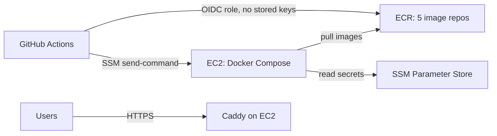
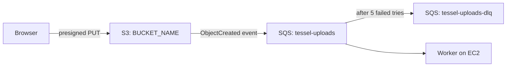

# AWS setup

One-time setup for automatic deploys. After this, every push to `main` that passes CI builds the images, pushes them to ECR, and deploys them to one EC2 host.



Commands use `ap-south-1` (Mumbai) and placeholder IDs. Replace `ACCOUNT_ID`, `REGION`, `INSTANCE_ID`, `BUCKET_NAME`, and `BACKUP_BUCKET_NAME` everywhere, including in the policy files in `iam/`. Bucket names are global, so pick your own (for example `tessel-files-yourcompany`).

## 1. Image repositories

```bash
for repo in api worker mcp-server web migrate; do
  aws ecr create-repository --region ap-south-1 --repository-name "tessel-$repo" \
    --image-scanning-configuration scanOnPush=true
done
```

Optional: add a lifecycle policy to each repository to keep only the last 30 images.

## 2. File storage and upload events

Uploads go from the browser straight to S3. S3 then puts an event on an SQS queue, and the worker picks it up and indexes the document.



1. Create the files bucket, private and encrypted:
   ```bash
   aws s3api create-bucket --region ap-south-1 --bucket BUCKET_NAME \
     --create-bucket-configuration LocationConstraint=ap-south-1
   aws s3api put-public-access-block --bucket BUCKET_NAME \
     --public-access-block-configuration BlockPublicAcls=true,IgnorePublicAcls=true,BlockPublicPolicy=true,RestrictPublicBuckets=true
   aws s3api put-bucket-encryption --bucket BUCKET_NAME \
     --server-side-encryption-configuration '{"Rules":[{"ApplyServerSideEncryptionByDefault":{"SSEAlgorithm":"AES256"}}]}'
   ```
2. Let the web app upload to it (replace the origin with your web domain):
   ```bash
   aws s3api put-bucket-cors --bucket BUCKET_NAME --cors-configuration '{
     "CORSRules": [{ "AllowedOrigins": ["https://app.example.com"], "AllowedMethods": ["PUT", "GET"],
                     "AllowedHeaders": ["*"], "ExposeHeaders": ["ETag"], "MaxAgeSeconds": 3600 }]
   }'
   ```
3. Create the queue and its dead-letter queue. Messages that fail five times move to the dead-letter queue instead of retrying forever:
   ```bash
   aws sqs create-queue --region ap-south-1 --queue-name tessel-uploads-dlq \
     --attributes MessageRetentionPeriod=1209600
   aws sqs create-queue --region ap-south-1 --queue-name tessel-uploads --attributes '{
     "VisibilityTimeout": "60",
     "RedrivePolicy": "{\"deadLetterTargetArn\":\"arn:aws:sqs:ap-south-1:ACCOUNT_ID:tessel-uploads-dlq\",\"maxReceiveCount\":\"5\"}"
   }'
   ```
4. Allow the bucket to send events to the queue, then turn the events on for uploaded originals only:
   ```bash
   aws sqs set-queue-attributes --region ap-south-1 \
     --queue-url https://sqs.ap-south-1.amazonaws.com/ACCOUNT_ID/tessel-uploads \
     --attributes '{"Policy": "{\"Statement\":[{\"Effect\":\"Allow\",\"Principal\":{\"Service\":\"s3.amazonaws.com\"},\"Action\":\"sqs:SendMessage\",\"Resource\":\"arn:aws:sqs:ap-south-1:ACCOUNT_ID:tessel-uploads\",\"Condition\":{\"ArnEquals\":{\"aws:SourceArn\":\"arn:aws:s3:::BUCKET_NAME\"}}}]}"}'
   aws s3api put-bucket-notification-configuration --bucket BUCKET_NAME --notification-configuration '{
     "QueueConfigurations": [{
       "QueueArn": "arn:aws:sqs:ap-south-1:ACCOUNT_ID:tessel-uploads",
       "Events": ["s3:ObjectCreated:*"],
       "Filter": { "Key": { "FilterRules": [{ "Name": "prefix", "Value": "workspaces/" },
                                            { "Name": "suffix", "Value": "/original" }] } }
     }]
   }'
   ```
5. Optional, for Postgres on the host: a backups bucket that keeps 30 days of nightly backups.
   ```bash
   aws s3api create-bucket --region ap-south-1 --bucket BACKUP_BUCKET_NAME \
     --create-bucket-configuration LocationConstraint=ap-south-1
   aws s3api put-public-access-block --bucket BACKUP_BUCKET_NAME \
     --public-access-block-configuration BlockPublicAcls=true,IgnorePublicAcls=true,BlockPublicPolicy=true,RestrictPublicBuckets=true
   aws s3api put-bucket-lifecycle-configuration --bucket BACKUP_BUCKET_NAME --lifecycle-configuration '{
     "Rules": [{ "ID": "expire-backups", "Status": "Enabled", "Filter": { "Prefix": "postgres/" },
                 "Expiration": { "Days": 30 } }]
   }'
   ```

## 3. Email (Amazon SES)

Tessel emails signup codes, password reset links, and security notices through SES.

1. Verify your domain so mail can come from it (replace `example.com`):
   ```bash
   aws sesv2 create-email-identity --region ap-south-1 --email-identity example.com
   ```
   The output lists three DKIM `CNAME` records. Add them to your DNS; SES marks the domain verified within about an hour. Check with:
   ```bash
   aws sesv2 get-email-identity --region ap-south-1 --email-identity example.com \
     --query VerifiedForSendingStatus
   ```
2. New SES accounts can only send to verified addresses. Ask AWS to lift that (production access):
   ```bash
   aws sesv2 put-account-details --region ap-south-1 --production-access-enabled \
     --mail-type TRANSACTIONAL --website-url https://app.example.com \
     --use-case-description "Account emails for Tessel users: sign-up codes, password resets, and security notices. Users only get mail for actions they take."
   ```
   Approval usually takes a day. Until then, verify your own address with `create-email-identity` to test.
3. Set `MAIL_FROM` to an address on the verified domain, such as `Tessel <no-reply@example.com>` (section 5).

The instance role's `SendEmail` statement only allows mail from identities in this account.

### Optional: Google and GitHub sign-in

"Continue with Google" and "Continue with GitHub" appear once their OAuth apps are set (section 5). Each callback URL is on the API domain.

- **Google:** in Google Cloud Console, open **APIs & Services → Credentials → Create credentials → OAuth client ID**, type **Web application**. Authorized redirect URI: `https://api.example.com/auth/oauth/google/callback`. Configure the consent screen with the scopes `openid`, `email`, and `profile`, and publish it. Store `GOOGLE_CLIENT_ID` and `GOOGLE_CLIENT_SECRET`.
- **GitHub:** in **Settings → Developer settings → OAuth Apps → New OAuth App**, set the callback URL to `https://api.example.com/auth/oauth/github/callback`. Store `GITHUB_CLIENT_ID` and `GITHUB_CLIENT_SECRET`. This is a different app from the GitHub connector's (`GITHUB_MCP_CLIENT_ID`).

### Optional: sign-in by text message (Amazon SNS)

Phone sign-in stays hidden until `SMS_TRANSPORT=sns` is set.

1. Attach [`iam/ec2-sms-policy.json`](iam/ec2-sms-policy.json) to the `tessel-ec2` role as a second inline policy. It allows texting phone numbers and nothing else (publishing to topics is denied).
2. New accounts are in the SMS sandbox, which only texts verified numbers. In the SNS console, open **Text messaging (SMS)** and request production access, and raise the monthly spending limit from its 1 USD default.
3. Indian numbers need DLT registration: register your business and a template such as `{#var#} is your Tessel sign-in code. It expires in 10 minutes. Don't share it.`, then store `SMS_DLT_ENTITY_ID`, `SMS_DLT_TEMPLATE_ID`, and the registered `SMS_SENDER_ID`. Tessel sends two texts (sign-in and confirming a number); register both wordings from `apps/api/src/lib/sms.ts`.

## 4. EC2 host

1. Create an IAM role for EC2 named `tessel-ec2` with:
   - the managed policy `AmazonSSMManagedInstanceCore` (lets deploys reach the host without SSH)
   - an inline policy from [`iam/ec2-instance-policy.json`](iam/ec2-instance-policy.json) (pull images, read `/tessel/prod/*` secrets, use the files bucket and upload queue, write backups)
2. Launch an instance:
   - Amazon Linux 2023, `t3.large` or larger (8 GB of memory runs the apps and every database). Use `t3.medium` if databases are managed elsewhere.
   - 40 GB gp3 disk.
   - Instance profile: `tessel-ec2`.
   - Security group: allow inbound 80 and 443 from anywhere. No SSH port is needed.
   - User data: the contents of [`bootstrap-ec2.sh`](bootstrap-ec2.sh).
   - Advanced details → Metadata response hop limit: **2**. The apps run in containers, one network hop further from the instance metadata service than the host; with the default of 1 they can't get the instance role's credentials. For an existing instance:
     ```bash
     aws ec2 modify-instance-metadata-options --instance-id INSTANCE_ID \
       --http-tokens required --http-put-response-hop-limit 2
     ```
3. Attach an Elastic IP so the address survives restarts.
4. Point DNS `A` records at the Elastic IP: `app.`, `api.`, and `mcp.` on your domain. Caddy requests HTTPS certificates for them on first start.

## 5. Secrets

Every app secret is an SSM `SecureString` under `/tessel/prod`. [`../deploy/secrets.example`](../deploy/secrets.example) lists each one. For example:

```bash
put() { aws ssm put-parameter --region ap-south-1 --type SecureString --overwrite --name "/tessel/prod/$1" --value "$2"; }
put JWT_ACCESS_SECRET "$(openssl rand -base64 48)"
put ENCRYPTION_KEY "$(openssl rand -base64 32)"
put API_PUBLIC_URL "https://api.example.com"
put MCP_PUBLIC_URL "https://mcp.example.com"
put WEB_ORIGIN "https://app.example.com"
put MAIL_FROM "Tessel <no-reply@example.com>"
put S3_BUCKET "BUCKET_NAME"
put SQS_UPLOADS_QUEUE_URL "https://sqs.ap-south-1.amazonaws.com/ACCOUNT_ID/tessel-uploads"
put AI_GATEWAY_API_KEY "<your Vercel AI Gateway key>"
# ...and the rest from secrets.example
```

`deploy.sh` writes them to `/opt/tessel/.env` on each deploy (readable only by root).

## 6. GitHub deploy role

1. Add GitHub as an identity provider (once per AWS account):
   ```bash
   aws iam create-open-id-connect-provider \
     --url https://token.actions.githubusercontent.com \
     --client-id-list sts.amazonaws.com
   ```
2. Create a role named `tessel-github-deploy`:
   - trust policy: [`iam/github-oidc-trust-policy.json`](iam/github-oidc-trust-policy.json) (only this repo's `production` environment can assume it)
   - inline policy: [`iam/github-deploy-policy.json`](iam/github-deploy-policy.json) (push to `tessel-*` repos, run commands on this one instance)

## 7. GitHub variables

In the repository, open **Settings → Secrets and variables → Actions → Variables** and add:

| Variable              | Example                                                      |
| --------------------- | ------------------------------------------------------------ |
| `AWS_REGION`          | `ap-south-1`                                                 |
| `AWS_DEPLOY_ROLE_ARN` | `arn:aws:iam::123456789012:role/tessel-github-deploy`        |
| `ECR_REGISTRY`        | `123456789012.dkr.ecr.ap-south-1.amazonaws.com`              |
| `EC2_INSTANCE_ID`     | `i-0abc123def4567890`                                        |
| `WEB_DOMAIN`          | `app.example.com`                                            |
| `API_DOMAIN`          | `api.example.com`                                            |
| `MCP_DOMAIN`          | `mcp.example.com`                                            |
| `ACME_EMAIL`          | `you@example.com` (Let's Encrypt expiry notices)             |
| `COMPOSE_PROFILES`    | `edge,data` (drop `data` when using RDS and ElastiCache)     |
| `IMAGE_PLATFORM`      | optional: `linux/arm64` for Graviton instances such as `t4g` |
| `BACKUP_BUCKET`       | optional: `BACKUP_BUCKET_NAME` for nightly Postgres backups  |

None of these are secret. Deploys stay off until `AWS_DEPLOY_ROLE_ARN` is set.

## 8. First deploy

Run the **Deploy** workflow from the Actions tab (or push to `main`). It:

1. builds and pushes the five images, tagged with the commit,
2. writes `docker-compose.prod.yml`, `Caddyfile`, `deploy.sh`, and `deploy.env` to `/opt/tessel` over SSM,
3. runs `deploy.sh`: loads secrets, pulls images, starts databases, runs migrations, starts the apps, and waits for every health check,
4. rolls back to the previous image tag if the new version fails its health checks,
5. checks the live site over HTTPS.

## Operating the host

Open a shell without SSH: **Systems Manager → Session Manager → Start session**, then:

```bash
cd /opt/tessel
sudo docker compose -f docker-compose.prod.yml --env-file deploy.env ps
sudo docker compose -f docker-compose.prod.yml --env-file deploy.env logs -f api
sudo ./deploy.sh <previous-tag>   # manual rollback
sudo ./backup.sh                  # back up Postgres now
sudo ./restore.sh postgres/tessel-<timestamp>.dump   # restore a backup (stops the apps meanwhile)
```

## Checking the upload pipeline

- Messages waiting or in flight: `aws sqs get-queue-attributes --queue-url <url> --attribute-names ApproximateNumberOfMessages ApproximateNumberOfMessagesNotVisible`
- Anything in `tessel-uploads-dlq` failed five times. Read it, fix the cause, then redrive it from the SQS console.
- A document stuck as "Waiting to index" usually means the bucket notification or the queue policy is missing (step 2.4).

## Moving to managed data services

When you outgrow one host, move Postgres to RDS and Redis to ElastiCache (two clusters: one with `allkeys-lru`, one with `noeviction`), update the URLs in SSM, and remove `data` from `COMPOSE_PROFILES`. For more than one app host, put an Application Load Balancer in front and drop the `edge` profile.
