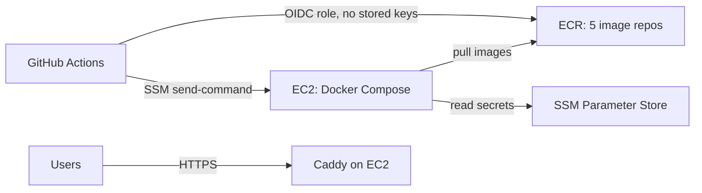

# AWS setup

One-time setup for automatic deploys. After this, every push to `main` that passes CI builds the images, pushes them to ECR, and deploys them to one EC2 host.



Commands use `ap-south-1` (Mumbai) and placeholder IDs. Replace `ACCOUNT_ID`, `REGION`, and `INSTANCE_ID` everywhere, including in the policy files in `iam/`.

## 1. Image repositories

```bash
for repo in api worker mcp-server web migrate; do
  aws ecr create-repository --region ap-south-1 --repository-name "tessel-$repo" \
    --image-scanning-configuration scanOnPush=true
done
```

Optional: add a lifecycle policy to each repository to keep only the last 30 images.

## 2. EC2 host

1. Create an IAM role for EC2 named `tessel-ec2` with:
   - the managed policy `AmazonSSMManagedInstanceCore` (lets deploys reach the host without SSH)
   - an inline policy from [`iam/ec2-instance-policy.json`](iam/ec2-instance-policy.json) (pull images, read `/tessel/prod/*` secrets)
2. Launch an instance:
   - Amazon Linux 2023, `t3.large` or larger (8 GB of memory runs the apps and every database). Use `t3.medium` if databases are managed elsewhere.
   - 40 GB gp3 disk.
   - Instance profile: `tessel-ec2`.
   - Security group: allow inbound 80 and 443 from anywhere. No SSH port is needed.
   - User data: the contents of [`bootstrap-ec2.sh`](bootstrap-ec2.sh).
3. Attach an Elastic IP so the address survives restarts.
4. Point DNS `A` records at the Elastic IP: `app.`, `api.`, and `mcp.` on your domain. Caddy requests HTTPS certificates for them on first start.

## 3. Secrets

Every app secret is an SSM `SecureString` under `/tessel/prod`. [`../deploy/secrets.example`](../deploy/secrets.example) lists each one. For example:

```bash
put() { aws ssm put-parameter --region ap-south-1 --type SecureString --overwrite --name "/tessel/prod/$1" --value "$2"; }
put JWT_ACCESS_SECRET "$(openssl rand -base64 48)"
put WEB_ORIGIN "https://app.example.com"
# ...and the rest from secrets.example
```

`deploy.sh` writes them to `/opt/tessel/.env` on each deploy (readable only by root).

## 4. GitHub deploy role

1. Add GitHub as an identity provider (once per AWS account):
   ```bash
   aws iam create-open-id-connect-provider \
     --url https://token.actions.githubusercontent.com \
     --client-id-list sts.amazonaws.com
   ```
2. Create a role named `tessel-github-deploy`:
   - trust policy: [`iam/github-oidc-trust-policy.json`](iam/github-oidc-trust-policy.json) (only this repo's `production` environment can assume it)
   - inline policy: [`iam/github-deploy-policy.json`](iam/github-deploy-policy.json) (push to `tessel-*` repos, run commands on this one instance)

## 5. GitHub variables

In the repository, open **Settings → Secrets and variables → Actions → Variables** and add:

| Variable              | Example                                                      |
| --------------------- | ------------------------------------------------------------ |
| `AWS_REGION`          | `ap-south-1`                                                 |
| `AWS_DEPLOY_ROLE_ARN` | `arn:aws:iam::123456789012:role/tessel-github-deploy`        |
| `ECR_REGISTRY`        | `123456789012.dkr.ecr.ap-south-1.amazonaws.com`              |
| `EC2_INSTANCE_ID`     | `i-0abc123def4567890`                                        |
| `WEB_DOMAIN`          | `app.example.com`                                            |
| `API_DOMAIN`          | `api.example.com`                                            |
| `MCP_DOMAIN`          | `mcp.example.com`                                            |
| `ACME_EMAIL`          | `you@example.com` (Let's Encrypt expiry notices)             |
| `COMPOSE_PROFILES`    | `edge,data` (drop `data` when using RDS and ElastiCache)     |
| `IMAGE_PLATFORM`      | optional: `linux/arm64` for Graviton instances such as `t4g` |

None of these are secret. Deploys stay off until `AWS_DEPLOY_ROLE_ARN` is set.

## 6. First deploy

Run the **Deploy** workflow from the Actions tab (or push to `main`). It:

1. builds and pushes the five images, tagged with the commit,
2. writes `docker-compose.prod.yml`, `Caddyfile`, `deploy.sh`, and `deploy.env` to `/opt/tessel` over SSM,
3. runs `deploy.sh`: loads secrets, pulls images, starts databases, runs migrations, starts the apps, and waits for every health check,
4. rolls back to the previous image tag if the new version fails its health checks,
5. checks the live site over HTTPS.

## Operating the host

Open a shell without SSH: **Systems Manager → Session Manager → Start session**, then:

```bash
cd /opt/tessel
sudo docker compose -f docker-compose.prod.yml --env-file deploy.env ps
sudo docker compose -f docker-compose.prod.yml --env-file deploy.env logs -f api
sudo ./deploy.sh <previous-tag>   # manual rollback
```

## Moving to managed data services

When you outgrow one host, move Postgres to RDS and Redis to ElastiCache (two clusters: one with `allkeys-lru`, one with `noeviction`), update the URLs in SSM, and remove `data` from `COMPOSE_PROFILES`. For more than one app host, put an Application Load Balancer in front and drop the `edge` profile.
